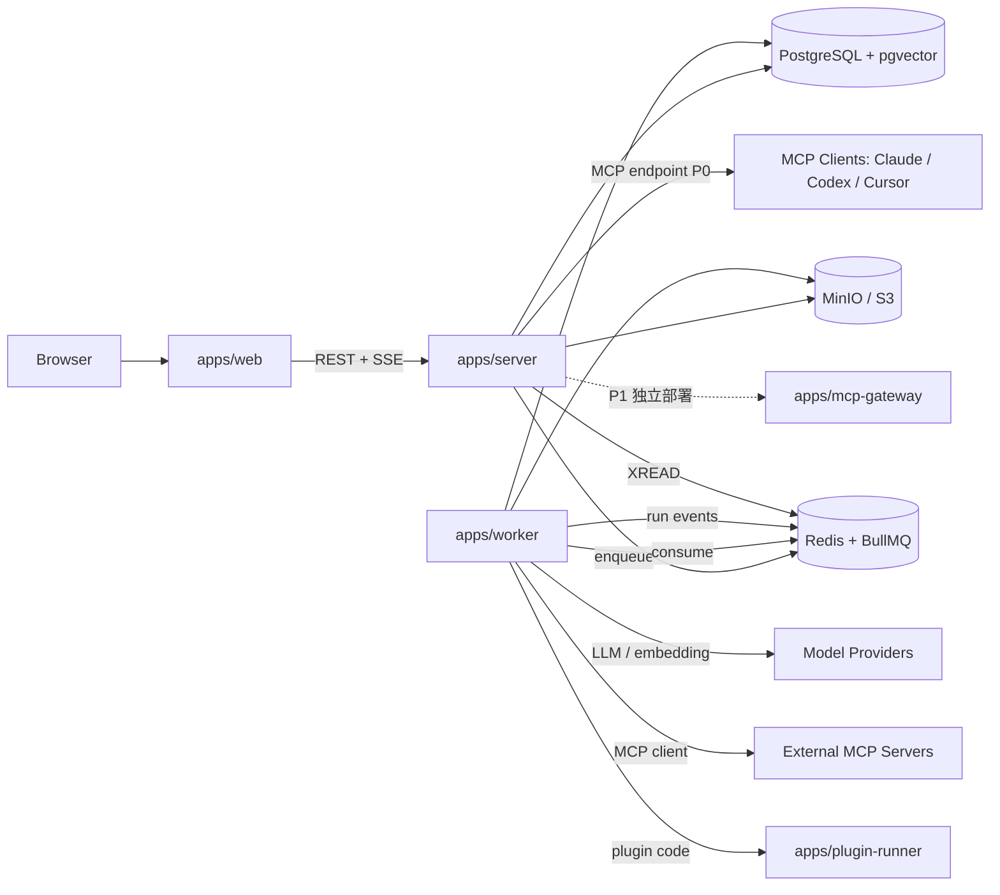
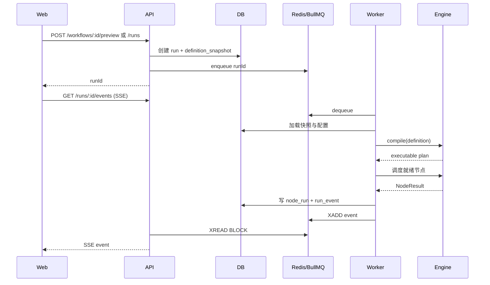

# 01 架构与技术方案

> 状态：整理稿，可作为架构评审基线。
> 技术约束：Vue 3.5.27+、Vite、UnoCSS、shadcn-vue 组件约定（底层使用 Reka UI）、@xyflow/vue（Vue Flow 2）；NestJS + PostgreSQL/pgvector + Redis/BullMQ；P0 不做登录鉴权。
> 技术栈与目录结构见 2.2/2.3；包合并与依赖方向见第 3 节。
> 关联模块：02 工作流与画布、03 属性面板、04 运行时与日志、05 节点目录、06 知识库、07 MCP、08 模型与 Skills、09/10 市场、12 流程设计器子应用。

## 1. 目标、边界与不变量

### 1.1 产品目标

`ai-reflow` 是一个可视化 AI 工作流工作室，核心不是“节点数量”，而是一个可调试、可回放、可被外部 Agent 调用的闭环：

```text
创建工作流 -> 画布编排 -> 节点配置 -> 预览运行 -> 查看事件/日志
-> 发布不可变版本 -> 发布版本试运行 -> HTTP/MCP 外部调用 -> 历史可解释
```

### 1.2 P0 / P0.5 / P1 范围

| 阶段 | 范围 |
| --- | --- |
| P0 | 工作流 CRUD、画布、8 个节点（`start/output/llm/tool/knowledge/condition/template/variable`）、草稿预览、发布版本试运行、SSE、日志、发布、知识库、MCP 客户端、Workflow as MCP Tool、模型连接 |
| P0.5 | `data-transform`、`document`、`parallel`，以及 `llm.mode=classify/extract`、`output.mode=chat_response/api_response` |
| P1 | `agent`、`loop`、`subworkflow`、`human`、`wait`、`code`、`database`、`quality-gate`、`file`；插件市场、模板市场、隔离 runner、Skills |

### 1.3 明确不做

- P0 不做登录、RBAC、SSO、计费、审计合规；但所有业务表保留 `workspace_id`。
- P0 不做多人协同、CRDT、复杂循环、子流程、人工审批、定时/事件触发。
- P0 不做社区插件市场；P1 只做官方 seed catalog 与受控安装。
- 不在 `server`/`web` 主进程执行第三方代码；不使用 `eval`/`new Function`。

### 1.4 架构不变量

1. 编辑器与运行时分离：前端只编辑 JSON 定义，执行只发生在 worker。
2. 发布版本不可变：`workflow_versions` 只能新增，不能原地修改。
3. 预览与正式运行使用同一引擎，只通过 `runKind` 区分保留策略。
4. Node Manifest 是画布、表单、校验、执行、文档的单一来源。
5. 运行事件先落库再发 Redis，SSE 的 `id` 使用单调递增 `seq`。
6. 节点输出超过阈值写对象存储，事件只带 `artifact` 摘要。
7. 变量引用只允许点路径/数组索引；条件是结构化 AST。
8. 所有业务查询必须带 `workspace_id`；密钥只存 `secret_ref` 或密文。
9. 生产工作流/子流程/插件使用必须固定版本；`latest` 只用于预览。
10. 插件/模板依赖必须可解释、可回滚，不能静默安装或覆盖。
11. 节点类型只有一个注册入口 `registerNode()`：Manifest、表单、渲染器、执行器查找都从注册表取，不维护第二份清单。
12. 每个节点必须实现 `doExecute()`，公共逻辑在 `BaseNodeExecutor.execute()` 中统一完成：校验、变量解析、超时、日志、输出校验、错误归一化。
13. 表单随节点注册自动注册；解析优先级为自定义组件 > JSON Schema（含 `x-*`）> `configFields` > 只读兜底。
14. 流程设计器是独立子应用 `apps/web/src/workflow/`，只编辑 JSON、不执行业务、不直接 import 业务 feature。
15. 草稿预览不绑定发布版本；发布后试运行必须绑定不可变 `workflow_version_id`，使用 `runKind=production` + `trigger=manual_trial`，不得隐式使用 latest。

## 2. 总体架构



### 2.1 进程职责

| 进程 | 职责 | 禁止 |
| --- | --- | --- |
| `apps/web` | 首页、流程设计器（`src/workflow`）、属性面板、预览、日志、知识库、MCP、模型、市场 UI | 持有模型密钥、连数据库、执行节点 |
| `apps/web/src/workflow` | 节点/边渲染、Inspector 表单、命令栈、校验、运行态叠加、设计器公共挂载契约 | import 业务 feature、直接 `fetch`、打包执行器 |
| `apps/server` | 控制面：CRUD、版本、运行创建、查询、SSE、MCP 配置、知识库元数据；P0 承载 MCP endpoint | 长任务执行、大文件处理、embedding |
| `apps/worker` | BullMQ 消费、DAG 调度、节点执行、ingestion、事件写入 | 暴露公网 HTTP、承担交互式查询 |
| `apps/plugin-runner` | P1：隔离执行第三方代码/代码节点；资源与网络限额 | 访问 api/db 内部实现、持有明文密钥 |
| `apps/server` 的 MCP 入口 | P0 把工作流暴露为 MCP Tool；P1 可拆为独立进程 | 绕过控制面直接改数据库 |

### 2.2 技术栈

选型原则：优先“一个能力只有一个主选型”，避免同类库混用；核心链路保持 TypeScript 单语言；第三方代码只进隔离 runner。

| 层级 | 选型 | 版本基线 | 用途 | 约束 |
| --- | --- | --- | --- | --- |
| 语言 | TypeScript（strict） | 5.9.x | 前后端共享类型与 schema | 禁止 `any` 逃逸；核心链路不引入第二语言 |
| 包管理 | pnpm + `catalog:` | pnpm 10 | workspace 依赖与统一版本 | 不混用 npm/yarn；CI 用 `--frozen-lockfile` |
| 任务编排 | Turborepo | 2.x | 任务图、缓存、affected 构建 | 合并主分支跑全量 |
| 运行时 | Node.js LTS | 24.x | server/worker/web 构建 | 生产镜像固定 digest/tag |
| 前端框架 | Vue | 3.5.27+ | 工作流工作室 | 满足 `@xyflow/vue` peer；不使用 React/Next.js |
| 构建 | Vite | 7.x | web 开发与构建 | 不使用 Webpack |
| 原子化 CSS | UnoCSS | 0.6x | 设计令牌与 shortcuts | 不与 Tailwind 混用 |
| UI 组件层 | shadcn-vue + Reka UI | - | `@ai-reflow/ui` 统一维护 Button、Input、Select、Dialog 等组件 | 页面只从 `@ai-reflow/ui` 导入；业务代码不直接依赖 Reka UI；Toast 使用 Vue Sonner |
| 画布 | `@xyflow/vue`（Vue Flow 2）+ dagre/elkjs | 2.x | 节点、边、Handle、缩略图、布局 | 同一包内置 Background/Controls/MiniMap；超过 300 节点启用性能模式 |
| 客户端状态 | Pinia | 3.x | 编辑器命令栈与 UI 状态 | 服务端数据不进 Pinia |
| 服务端数据 | TanStack Query Vue | 5.x | 缓存、失效、轮询、错误态 | 组件不直接 `fetch` |
| 表单校验 | vee-validate + Zod | 4.x | Inspector 表单与共享 schema | 复杂节点可用自定义面板 |
| 代码编辑 | CodeMirror | 6.x | Prompt/JSON/SQL/代码编辑 | Monaco 仅 P1 按需引入 |
| 图标 | Lucide Vue | 0.5x | 统一线性图标 | 不混用多套图标包 |
| 后端框架 | NestJS | 11.x | server/worker 模块与 DI | 不用 Express 裸写控制器 |
| ORM/迁移 | Drizzle ORM + `postgres` | 0.4x | schema、Repository、迁移 | SQL 可控；禁止业务层拼裸 SQL |
| 主数据库 | PostgreSQL + pgvector | 17 | 关系数据、JSONB、向量 | 所有查询带 `workspace_id` |
| 队列 | Redis + BullMQ | Redis 7 / BullMQ 5 | 运行队列、重试、延迟任务 | 长任务不阻塞 API |
| 实时事件 | Redis Stream + SSE | Redis 7 | 事件回放与多消费者 | P0 不用 WebSocket |
| 对象存储 | MinIO（S3 兼容） | 最新稳定 | 文档、附件、大输出、插件包 | 生产可换 S3/OSS |
| 模型接入 | Vercel AI SDK + Provider 适配 | 5.x | 流式、工具调用、多模型 | 核心不绑定 LangChain |
| MCP | `@modelcontextprotocol/sdk` | 1.x | MCP 客户端与服务端 | 不自研协议封装 |
| 市场校验 | Zod + `semver` + `tar` + Ajv | 最新稳定 | manifest、依赖、JSON Schema | 不在运行时安装 npm 包 |
| 模板 | `mustache` | 4.x | 受限变量替换 | 禁止可执行 helper |
| JSONPath | `jsonpath-plus` | 10.x | 只读路径查询 | 禁用脚本表达式 |
| 文档解析 | `unpdf` + `mammoth` + `cheerio` + `xlsx` + `csv-parse` | 最新稳定 | PDF/DOCX/XLSX/XLS/CSV/HTML | 旧 `.doc` 由 LibreOffice worker 转换；OCR 独立服务，P1 |
| 文件预览 | `pdfjs-dist` + SheetJS + LibreOffice | 最新稳定 | PDF/Word/Excel/CSV 原文件预览 | Word 先转 HTML/PDF；HTML 必须消毒 |
| 可观测性 | Pino + OpenTelemetry（可选） | 9.x / 2.x | 结构化日志、trace、成本 | 日志必须脱敏 |
| API 契约 | OpenAPI + `openapi-typescript` + `openapi-fetch` | 最新稳定 | 类型安全客户端 | 生成文件必须与后端同步 |
| 单元测试 | Vitest | 3.x | 引擎、节点、Vue 组件 | 引擎测试不依赖网络/DB |
| 集成测试 | Testcontainers | 10.x | 真 Postgres/Redis | 不 mock 关键 DB 行为 |
| E2E | Playwright | 1.x | 画布、预览、日志、MCP 闭环 | 与 PR 快速流水线分离 |
| Lint/Format | ESLint 9 flat + Prettier | 9.x / 3.x | TS/Vue/Nest 统一风格 | 不以 Biome 作为唯一 lint |
| 类型检查 | `vue-tsc` + `tsc --noEmit` | 跟随 TS | SFC 与后端全量检查 | Turbo 统一执行 |
| 依赖治理 | Knip + license check | 最新稳定 | 死代码与许可证审计 | CI 必跑 |
| 部署 | Docker Compose + Nginx | 最新稳定 | 本地依赖与静态站点/SSE 代理 | 生产镜像非 root |

版本策略：

- 版本集中在 `pnpm-workspace.yaml` 的 `catalog:`，各包只引用 catalog 别名。
- Node/pnpm/Postgres/Redis 版本写入 `.nvmrc`、`.tool-versions` 与 compose 镜像 tag。
- 新增依赖前回答：维护活跃度、许可证、包体积、运行时成本、是否有更轻替代。
- 每季度集中升级；安全补丁不受窗口限制；生产禁用 `latest`。

明确不引入：

- React/Redux/Next.js、Vuex、WebSocket（P0）、自研 fetch 缓存。
- 在 `server`/`web` 主进程执行 `eval`/`new Function`/第三方代码。
- 以 LangChain 作为核心编排层；节点执行语义必须由本仓库显式定义。
- 可执行 helper 的模板引擎、脚本型 JSONPath 表达式。

画布包约定：统一使用 `@xyflow/vue` 2.x，不混用 `@vue-flow/core`；旧 1.x 教程中的 `v-model="elements"`、`applyNodeChanges`、原地修改节点等写法不能直接照搬。

### 2.3 目标目录结构

顶层只保留 4 个 app、7 个 package 和必要基础设施目录；原 16 个包不再保留物理目录。

```text
ai-reflow/
├─ apps/
│  ├─ web/                    # Vue 3 工作流工作室（含 src/workflow 流程设计器子应用）
│  ├─ server/                 # NestJS 控制面 + P0 MCP endpoint
│  ├─ worker/                 # 队列消费、DAG 调度、节点执行
│  └─ plugin-runner/          # P1 隔离执行第三方代码/插件
├─ packages/
│  ├─ core/                   # 协议层：类型、Zod/JSON Schema、Manifest、节点注册、事件
│  ├─ engine/                 # 纯 DAG 编译/校验/调度 + runtime 上下文
│  ├─ capabilities/           # 节点实现、模型/知识库/MCP 适配
│  ├─ marketplace/            # registry、semver、签名、插件 SDK
│  ├─ platform/               # DB、队列、存储、可观测性
│  ├─ ui/                     # 设计令牌与无业务组件
│  └─ tooling/                # tsconfig/eslint/unocss/vitest 基座与 testkit
├─ infra/
│  ├─ compose/                # postgres/redis/minio 等本地依赖
│  ├─ nginx/                  # 静态站点与 SSE 反向代理
│  └─ migrations/             # 迁移执行入口（实际文件在 platform/db）
├─ scripts/                   # 发布、校验、数据修复脚本
├─ docs/                      # 原稿，只读，不再修改
├─ docs-new/                  # 本整理稿
├─ pnpm-workspace.yaml
├─ turbo.json
├─ package.json
├─ tsconfig.base.json
└─ .env.example
```

应用内部结构：

```text
apps/web/src/
├─ pages/                     # 首页、工作流、运行、知识库、MCP、模型、市场
├─ features/                  # 按业务域组织：workflows/runs/knowledge/mcp/models/marketplace
├─ workflow/                  # 独立流程设计器子应用（见 12）
│  ├─ index.ts                # 唯一公共入口：mountWorkflowDesigner / 类型
│  ├─ canvas/ palette/ inspector/ forms/ commands/ validation/ runtime/
│  ├─ api/                    # WorkflowDesignerPort 默认适配器
│  └─ shared/                 # 与 runs 页共享的展示组件（无业务请求）
├─ components/                # 跨域业务组件
├─ api/                       # generated/openapi schema、client、queries
├─ stores/                    # Pinia：编辑器命令栈与 UI 状态
├─ router/
├─ styles/
└─ main.ts

apps/server/src/
├─ main.ts
├─ modules/                   # workflows/versions/runs/events/knowledge/mcp/models/marketplace/secrets/health
├─ common/                    # filters、guards、errors、interceptors
└─ openapi/                   # Swagger 文档与生成入口

apps/worker/src/
├─ main.ts
├─ consumers/                 # run/publish/ingest/cleanup
├─ pipeline/                  # planner、scheduler、executor
├─ handlers/                  # 节点执行器注册与分发
└─ bootstrap/

apps/plugin-runner/src/
├─ main.ts
├─ sandbox/                   # node/python 隔离执行
├─ protocol/                  # 与 worker 的受限协议
└─ limits/                    # CPU/内存/网络/超时
```

包内部结构：

```text
packages/core/src/{workflow,node,events,api}/   # node 含 Manifest/NodeRegistration/registerNode/BaseNodeExecutor 契约
packages/engine/src/{graph,runtime}/
packages/capabilities/src/{nodes,providers,knowledge,mcp}/
packages/marketplace/src/{registry,plugin-sdk}/
packages/platform/src/{db,queue,storage,observability}/
packages/ui/src/{tokens,components,styles}/
packages/tooling/src/{config,testkit,fixtures}/
```

目录规则：

- `apps/*` 只做组合、Controller/Consumer 与适配；业务规则必须下沉到 package。
- `apps/*` 之间禁止互相 import；共享逻辑放 `packages/*`。
- 所有跨包引用走 `exports` 子路径，禁止 `src/...` deep import。
- 单测与被测文件同目录（`*.spec.ts`）；集成测试用 `*.int.spec.ts`；E2E 放 `apps/web/e2e/`。
- 节点 fixture 放 `packages/capabilities/src/nodes/<node>/__fixtures__/`，至少输入、输出、错误各一个。
- 数据库迁移文件放 `packages/platform/src/db/migrations/`；`infra/migrations` 只做入口，不重复维护。
- `docs/` 保持只读；新增或重写文档只进 `docs-new/`，避免两套文档继续漂移。
- 生成文件（OpenAPI schema、JSON Schema）必须标注 `@generated`，并由 CI 校验是否最新。

## 3. Monorepo 与包合并方案

### 3.1 原结构的问题

原方案有 16 个 `packages/*`，其中多个包只有类型或薄适配层，导致：

- 依赖链过长：改一个事件字段要跨 4–5 个包。
- 边界看似精细，实际重复：`contracts` 与 `schema`、`node-sdk` 与 `nodes` 的边界频繁漂移。
- `runtime` 与 `engine` 分开，但发布/测试总是一起改。
- `config`、`testkit` 作为包增加了安装与配置成本，却没有产品价值。

### 3.2 目标包结构（7 个 packages）

| 目标包 | 合并来源 | 对外子路径 | 责任 |
| --- | --- | --- | --- |
| `@ai-reflow/core` | `contracts`、`reflow-schema`、`reflow-node-sdk` | `/workflow`、`/node`、`/events`、`/api` | 纯类型、Zod/JSON Schema、Manifest 类型、节点注册与 `BaseNodeExecutor` 契约、事件 envelope、脱敏规则 |
| `@ai-reflow/engine` | `reflow-engine`、`reflow-runtime` | `/graph`、`/runtime` | 纯 DAG 编译/校验/调度 + 执行上下文、重试、端口接口 |
| `@ai-reflow/capabilities` | `reflow-nodes`、`reflow-providers`、`reflow-knowledge`、`reflow-mcp` | `/nodes`、`/providers`、`/knowledge`、`/mcp` | 内置节点实现、模型/embedding/rerank 适配、解析与向量、MCP 客户端 |
| `@ai-reflow/marketplace` | `reflow-registry`、`reflow-plugin-sdk` | `/registry`、`/plugin-sdk` | manifest、semver、依赖解析、checksum/签名、catalog、插件类型与测试 harness |
| `@ai-reflow/platform` | `db`、`reflow-observability` 的落库部分 | `/db`、`/queue`、`/storage`、`/observability` | Drizzle schema/迁移、Repository、队列/SSE/对象存储适配、Pino/redaction |
| `@ai-reflow/ui` | `ui` | - | 设计令牌、shadcn-vue 组件源码与导出、共享 UI 组件 |
| `@ai-reflow/tooling` | `config`、`testkit` | `/config`、`/testkit` | tsconfig/eslint/unocss/vitest 基座、fixture、Testcontainers helper |

### 3.3 Apps 收敛

| 阶段 | apps |
| --- | --- |
| 原方案 | `web`、`api`、`worker`、`mcp-gateway`、`plugin-runner` |
| 本稿 P0 | `web`（含 `src/workflow` 设计器子应用）、`server`（含 MCP 入口模块）、`worker`、`plugin-runner` 空壳 |
| P1 拆分条件 | MCP 需要独立扩缩/独立鉴权/独立部署时，再从 `server` 拆出 `mcp-gateway`；设计器需要独立部署时，把 `src/workflow` 迁为 `apps/workflow`；包边界不变 |

### 3.4 依赖方向

```text
tooling              -> 无产品依赖
core                 -> 无运行时依赖
engine               -> core
platform             -> core
capabilities         -> core + platform（仅通过端口/Repository 接口）
marketplace          -> core
ui                   -> 无业务依赖
server               -> core + engine + platform + marketplace
worker               -> core + engine + capabilities + platform + marketplace
plugin-runner        -> core + marketplace
web                  -> core + ui + engine/graph
web/src/workflow     -> core + ui + engine/graph + OpenAPI client（仅 Port 适配器）
```

硬规则：

- `apps/*` 之间不得互相 import；共享逻辑下沉到包。
- `engine` 的 `/graph` 必须是纯逻辑：不访问 DB、Redis、HTTP、文件系统。
- `engine` 的 `/runtime` 通过端口接口调用持久化/事件，不直接 import Drizzle。
- `web` 不直接依赖 `platform`，不读取数据库、不执行节点。
- `web/src/workflow` 禁止 import `capabilities` 执行器、`platform` 和业务 feature（knowledge/models/mcp/marketplace/runs）；需要选项数据时通过 `DesignerServices` 注入。
- 设计器内禁止裸 `fetch`；所有 I/O 走 `WorkflowDesignerPort`。
- `capabilities` 不得依赖 `apps/*`；节点实现不感知 Nest Controller。
- 所有跨包导入走 `exports`，禁止 deep import。
- 新包必须先在本文件更新结构与依赖方向，再落地。

### 3.5 包合并原则

1. **按变更频率合并**：总是同时修改的包合并；例如 engine/runtime、registry/plugin-sdk。
2. **按生命周期合并**：schema/contracts/node-sdk 都是“协议层”，合并为 core。
3. **保留安全边界**：plugin-runner 不合并；第三方代码隔离是硬边界。
4. **保留纯内核**：engine 合并 runtime，但 `/graph` 仍禁止 I/O，方便 90% 单测覆盖。
5. **控制包体职责**：一个包最多 3 个清晰子域；超过则拆回，不允许“misc/utils”大杂烩。

## 4. Reflow 编排协议

### 4.1 Workflow 定义

```json
{
  "schemaVersion": 1,
  "id": "wf_support_triage",
  "version": 3,
  "nodes": [
    {
      "id": "n_start",
      "type": "start",
      "version": "1.0.0",
      "title": "开始",
      "position": { "x": 80, "y": 180 },
      "config": {
        "entryMode": "manual",
        "inputSchema": {
          "type": "object",
          "properties": { "question": { "type": "string" } },
          "required": ["question"]
        }
      }
    },
    {
      "id": "n_llm",
      "type": "llm",
      "version": "1.0.0",
      "title": "生成回答",
      "position": { "x": 360, "y": 180 },
      "config": {
        "mode": "generate",
        "modelConnectionId": "mc_openai",
        "prompt": "{{ $input.question }}"
      }
    },
    {
      "id": "n_end",
      "type": "output",
      "version": "1.0.0",
      "title": "结束",
      "position": { "x": 640, "y": 180 },
      "config": {
        "mode": "workflow_output",
        "content": "{{ $node.n_llm.output.text }}",
        "final": true
      }
    }
  ],
  "edges": [
    { "id": "e1", "source": "n_start", "sourceHandle": "out", "target": "n_llm", "targetHandle": "in" },
    { "id": "e2", "source": "n_llm", "sourceHandle": "out", "target": "n_end", "targetHandle": "in" }
  ],
  "settings": { "concurrency": 4, "timeoutMs": 600000, "maxNodeAttempts": 2 }
}
```

约定：

- `node.id` 工作流内唯一且稳定；改名不改 ID。
- `edge.sourceHandle` 必须对应节点输出端口；条件节点按 `branch` 激活边。
- 草稿允许不完整；预览/发布前必须通过编译校验。
- 默认只允许 DAG；`loop` 是 P1 且需深度/次数限制。
- 发布时保存完整 `definition_snapshot`，历史运行不依赖最新 manifest。

### 4.2 Node Manifest

```ts
interface NodeManifest<TConfig = unknown> {
  type: string;
  version: string;
  category: 'entry' | 'output' | 'control' | 'data' | 'ai'
          | 'knowledge' | 'integration' | 'human' | 'reuse';
  displayName: string;
  description: string;
  configSchema: unknown;   // Zod -> JSON Schema
  inputSchema: unknown;
  outputSchema: unknown;
  handles: { inputs: HandleDef[]; outputs: HandleDef[] };
  capabilities: {
    streaming?: boolean;
    cancellable?: boolean;
    idempotent?: boolean;
    sideEffect?: boolean;
    longRunning?: boolean;
    emitsArtifacts?: boolean;
  };
  runtime: 'builtin' | 'declarative' | 'sandbox';
}
```

> Manifest 只描述“节点是什么”；“怎么执行/怎么渲染/表单是什么”由注册项提供，避免把执行器塞进协议类型。

#### 4.2.1 节点注册：`defineNode` + `registerNode`

```ts
// packages/core/src/node/registration.ts
export interface NodeRegistration<TConfig = unknown> {
  manifest: NodeManifest<TConfig>;
  /** 仅 worker/执行进程注册；web 不打包执行器 */
  executor?: NodeExecutorFactory<TConfig>;
  /** 仅 web/设计器注册；worker 不打包表单 */
  form?: NodeFormRegistration;
  /** 节点渲染器覆盖；缺省用通用节点卡片 */
  component?: unknown;
  /** 节点级示例，供 Inspector 与测试使用 */
  examples?: NodeExample[];
}

export function defineNode<T>(registration: NodeRegistration<T>): NodeRegistration<T>;
export function registerNode<T>(registration: NodeRegistration<T>): void;
export function unregisterNode(type: string): void;
export function onNodeRegistryChange(listener: () => void): () => void;
```

```ts
// packages/capabilities/src/nodes/llm/index.ts
export const llmNode = defineNode({
  manifest: llmManifest,
  executor: () => new LlmExecutor(),
  form: { kind: 'schema', schema: llmConfigJsonSchema },
  examples: [llmGenerateExample, llmClassifyExample],
});

// packages/capabilities/src/nodes/index.ts
export function registerBuiltinNodes(target: 'web' | 'worker' | 'api') {
  for (const node of builtinNodes) {
    registerNode(projectRegistration(node, target));
  }
}
```

进程投影：

| 进程 | manifest | form | executor | component | 用途 |
| --- | --- | --- | --- | --- | --- |
| `apps/web` | 是 | 是 | 否 | 是 | Palette、Inspector、校验、节点渲染 |
| `apps/worker` | 是 | 否 | 是 | 否 | 执行与输出校验 |
| `apps/server` | 是 | 否 | 否 | 否 | Manifest 投影、导入校验、文档生成 |
| `apps/plugin-runner` | 插件 manifest | 否 | 插件 executor | 否 | 隔离执行第三方代码 |

注册表语义：

- 按 `manifest.type` 合并；后注册字段覆盖先注册字段。
- 重复注册 `executor`/`form` 输出 `REGISTRY_OVERWRITE` 警告；生产默认拒绝覆盖，插件升级需显式 `allowOverwrite`。
- `unregisterNode(type)` 用于插件禁用/卸载；已打开工作流保留只读快照。
- 注册是进程内的；跨进程一致性由同一份 `defineNode` 源文件与构建期依赖检查保证。

#### 4.2.2 执行器基类：`execute` 与 `doExecute`

```ts
// packages/core/src/node/executor.ts
export abstract class BaseNodeExecutor<TConfig> {
  abstract readonly manifest: NodeManifest<TConfig>;

  /** 框架统一入口：不要覆写 */
  async execute(ctx: NodeExecutionContext, input: NodeInput): Promise<NodeOutput> {
    const config = await this.validateConfig(ctx, input);
    const resolved = await this.resolveVariables(ctx, config);
    const output = await this.runWithTimeout(ctx, () =>
      this.doExecute(ctx, resolved, input),
    );
    return this.validateOutput(ctx, output);
  }

  /** 节点业务逻辑：每个节点必须实现 */
  protected abstract doExecute(
    ctx: NodeExecutionContext,
    config: TConfig,
    input: NodeInput,
  ): Promise<NodeOutput>;

  // 公共能力：validateConfig / resolveVariables / runWithTimeout /
  // validateOutput / normalizeError / log 阶段事件
}
```

```ts
// packages/capabilities/src/nodes/llm/llm.executor.ts
export class LlmExecutor extends BaseNodeExecutor<LlmConfig> {
  readonly manifest = llmManifest;

  protected async doExecute(ctx: NodeExecutionContext, config: LlmConfig, input: NodeInput) {
    const prompt = config.prompt; // 已完成变量解析
    const result = await ctx.providers.llm.generate({ ...config, prompt });
    return { text: result.text, usage: result.usage, model: result.model };
  }
}
```

职责边界：

- `execute()` 负责：config 校验、变量解析、超时/取消、阶段日志、输出 schema 校验、错误归一化、上下文写入。
- `doExecute()` 只写业务：调用 provider/工具/数据库，返回 `NodeOutput`；不自行 sleep、不写日志格式、不吞错。
- 重试/attempt 由调度器负责；`doExecute()` 必须可被重复调用（幂等或声明 `sideEffect`）。
- 节点错误统一抛 `NodeExecutionError`（`code/retryable/details`），由基类补齐 `nodeId/attempt/type`。

迁移说明：现有 `packages/capabilities/src/index.ts` 的 `switch(type)` 分发在 M1.5 拆成每节点 `BaseNodeExecutor` 子类；过渡期可保留 switch，但必须调用同一基类公共逻辑，不得新增第二套日志/校验/变量解析。

### 4.3 变量与表达式

| 语法 | 作用域 | 规则 |
| --- | --- | --- |
| `$input.<name>` | 工作流输入 | 来自 start 节点 |
| `$node.<nodeId>.output.<path>` | 节点输出 | 只读；点路径/数组索引 |
| `$node.<nodeId>.meta.<path>` | 节点元数据 | 耗时、attempt、usage |
| `$vars.<name>` | 运行变量 | 由 variable 节点写入 |
| `$run.id` / `$run.kind` | 运行上下文 | `preview` / `production` |
| `$workflow.id` / `$workflow.version` | 工作流上下文 | 发布版本 |
| `$loop.item` / `$loop.index` | 循环作用域 | 仅 P1 loop 内 |

规则：不支持 `$env`、`$secrets`、任意 JS 或函数调用；缺失路径按 `error`/`empty`/`keep` 处理；条件使用 `eq/ne/gt/gte/lt/lte/in/contains/exists/regex` 的 AST。

## 5. 运行时设计

### 5.1 状态机

```text
queued -> running -> succeeded
                  -> failed
                  -> cancelled
                  -> waiting（P1：人工/回调）
node: pending -> running -> succeeded | failed | skipped | cancelled | waiting
```

### 5.2 执行流程



### 5.3 调度规则

1. 编译期校验：唯一 start、至少一个终止节点、边目标存在、无环、端口匹配、分支完整、变量可达。
2. 就绪集合：所有必需入边完成或跳过。
3. 并行受 `run.settings.concurrency` 与 worker 全局上限约束。
4. 条件节点返回 `branch`，非选中边下游标记 `skipped`。
5. 节点重试受 `maxNodeAttempts` 与节点级 `retry` 约束；`sideEffect` 节点默认不自动重试。
6. 节点超时通过 `AbortController`；run 超时取消全部未完成节点。
7. 取消写 `cancel_requested_at`，worker 轮询并中止；排队任务从 BullMQ 移除。
8. 创建 run 支持 `Idempotency-Key`；节点执行按 `(runId, nodeId, attempt)` 唯一。
9. 节点输出与事件同事务落库；Redis 可短暂延迟，DB 可补齐。

## 6. 数据模型摘要

所有主键使用 UUIDv7，所有业务表带 `workspace_id`，时间用 UTC。

| 表 | 关键字段 | 说明 |
| --- | --- | --- |
| `workspaces` | `id`, `name` | P0 单 `demo` workspace |
| `workflows` | `id`, `workspace_id`, `name`, `description`, `status`, `draft_definition` | 草稿与元数据 |
| `workflow_versions` | `id`, `workflow_id`, `version`, `definition`, `created_at` | 发布后不可变 |
| `runs` | `id`, `workflow_id`, `workflow_version_id`, `definition_snapshot`, `kind`, `trigger`, `status`, `input`, `output`, `error` | 运行主记录；`kind=preview/production`，`trigger=manual_preview/manual_trial/api/mcp/...` |
| `node_runs` | `id`, `run_id`, `node_id`, `attempt`, `status`, `input`, `output`, `error`, `usage` | 节点级执行 |
| `run_events` | `run_id`, `seq`, `type`, `node_id`, `payload` | append-only，`seq` 单调 |
| `artifacts` | `id`, `run_id`, `storage_key`, `mime`, `size`, `sha256` | 大输出/文件 |
| `model_connections` | `id`, `workspace_id`, `provider`, `base_url`, `model`, `secret_ref` | 模型连接 |
| `credentials` | `id`, `workspace_id`, `name`, `ciphertext`, `key_version` | AES-256-GCM |
| `knowledge_bases` | `id`, `workspace_id`, `name`, `embedding_model`, `embedding_dimension` | 单 embedding 维度 |
| `documents` | `id`, `kb_id`, `storage_key`, `status`, `error` | 原始文档 |
| `document_chunks` | `id`, `document_id`, `content`, `metadata`, `embedding` | pgvector |
| `mcp_connections` / `mcp_tools` | `workspace_id`, `scope_type`, `transport`, `endpoint`, `auth_type`, `schema`, `schema_hash`, `health` | 出站连接与工具缓存 |
| `workflow_mcp_exposures` | `workspace_id`, `workflow_id`, `workflow_version_id`, `tool_name`, `auth_mode`, `enabled` | 入站 Workflow as MCP Tool；只绑定发布版本 |
| `mcp_call_audit` | `server_id`, `tool_id`, `run_id`, `client_id`, `status`, `duration_ms` | 出站/入站调用审计；不记录明文凭据 |
| `registry_entries` / `registry_versions` | `id`, `kind`, `manifest`, `checksum`, `signature` | 市场目录 |
| `plugin_installs` / `plugin_credentials` | `entry_id`, `version`, `status`, `secret_ref` | workspace 级安装 |
| `template_catalog` / `template_versions` / `template_imports` | `manifest`, `required_*`, `missing_dependencies` | 模板与克隆记录 |

设计要点：

- Workflow 整体存 JSONB；P1 有检索需求再物化节点表。
- `run_events.payload` 不存完整大输出；大对象落 `artifacts`。
- `document_chunks.embedding` 维度必须与知识库配置一致。
- 密钥不落明文；日志/事件统一脱敏。
- P1 事件表按月分区；P0 先保留期 + 索引。

## 7. API 与 SSE 契约

### 7.1 REST 资源

| 方法 | 路径 | 说明 |
| --- | --- | --- |
| `GET/POST` | `/api/workflows` | 列表/创建；列表返回首页卡片 DTO |
| `GET/PATCH/DELETE` | `/api/workflows/:id` | 元数据与草稿；PATCH 带 `revision` |
| `POST` | `/api/workflows/:id/publish` | 发布不可变版本 |
| `GET` | `/api/workflows/:id/versions` | 版本列表 |
| `POST` | `/api/workflows/:id/preview` | 草稿预览运行 |
| `POST` | `/api/workflows/:id/runs` | 创建指定发布版本运行；`workflowVersionId` 必填 |
| `GET` | `/api/workflows/:id/versions/:versionId/readiness` | 发布后试运行就绪检查 |
| `GET` | `/api/runs` | 过滤 workflow/version/status/kind/trigger/时间/错误码 |
| `GET` | `/api/runs/:id` | 运行详情 |
| `GET` | `/api/runs/:id/node-runs` | 节点明细 |
| `GET` | `/api/runs/:id/events` | SSE；支持 `Last-Event-ID`/`after` |
| `POST` | `/api/runs/:id/cancel` | 取消 |
| `GET/POST` | `/api/knowledge-bases` | 知识库 |
| `POST` | `/api/knowledge-bases/:id/documents` | 上传 |
| `GET/POST` | `/api/mcp/servers` | 出站 MCP 连接 |
| `POST` | `/api/mcp/servers/:id/test` | 连接测试并刷新工具 |
| `GET/POST` | `/api/workflows/:id/mcp-exposure` | 入站暴露配置；绑定发布版本 |
| `POST` | `/api/workflows/:id/mcp-exposure/rotate-token` | 轮换入站访问 token |
| `GET/POST` | `/api/mcp/access-tokens` | 入站凭证元数据；不返回明文 |
| `GET` | `/api/mcp/calls` | MCP 调用审计 |
| `POST` | `/mcp` | MCP Streamable HTTP endpoint |
| `GET/POST/PATCH` | `/api/model-connections` | 模型连接 |
| `GET/POST` | `/api/skills`、`/api/skill-installs` | P1 Skills |
| `GET/POST` | `/api/registry/entries` | 市场目录 |
| `POST` | `/api/registry/install-plan` | 安装计划 |
| `GET/POST` | `/api/plugin-installs` | 安装列表/安装 |
| `POST` | `/api/plugin-installs/:id/upgrade` / `rollback` | 升级/回滚 |
| `GET/POST` | `/api/templates` | 模板列表 |
| `POST` | `/api/templates/:id/clone-plan` / `clone` | 依赖检查/克隆 |
| `GET` | `/api/admin/overview` | 运行、队列、错误、存储概览 |

### 7.2 SSE envelope

```ts
type RunEvent = {
  seq: number;
  runId: string;
  type: 'run.started' | 'node.started' | 'node.output' | 'node.failed'
      | 'node.skipped' | 'node.retry' | 'node.waiting' | 'node.resumed'
      | 'run.completed' | 'run.failed' | 'run.cancelled' | 'token.delta';
  nodeId?: string;
  attempt?: number;
  at: string;
  payload: unknown; // 已脱敏
};
```

- `seq` 是 run 内单调编号，SSE `id:` 直接使用。
- 生命周期与最终输出落 PostgreSQL；`token.delta` 可只走 Redis 短保留流。
- 重连带 `Last-Event-ID`；服务端先补齐再实时。
- Authorization、Cookie、API Key、密码字段不进入事件。

## 8. 前端总体功能

| 编号 | 功能点 | 说明 |
| --- | --- | --- |
| `APP-F01` | 应用壳与侧边栏 | 工作流、运行记录、节点设置、MCP、模型、Skills、市场入口 |
| `APP-F02` | 路由与深链 | `/`、`/workflows/:id`、`/workflows/:id/trial`、`/runs/:id`、`/nodes`、`/mcp`、`/models`、`/skills`、市场路由 |
| `APP-F03` | 统一 API client | 由 OpenAPI 生成；组件禁止裸 `fetch` |
| `APP-F04` | 查询缓存 | TanStack Query 管服务端数据；Pinia 管画布/UI 临时态 |
| `APP-F05` | 设计系统 | 令牌、`@ai-reflow/ui` shadcn-vue 组件、Lucide 图标、暗色模式 |
| `APP-F06` | 通用状态 | loading / empty / error / no-permission / unsaved |
| `APP-F07` | 键盘与可访问性 | 焦点管理、快捷键、对话/抽屉焦点回收 |
| `APP-F08` | 国际化 | `vue-i18n`；P0 至少抽出文案 key |
| `APP-F09` | SSE 客户端 | 统一重连、`Last-Event-ID`、错误态、批量 token 渲染 |
| `APP-F10` | 安全展示 | 密钥掩码、危险操作二次确认、引用失效提示 |
| `APP-F11` | 性能预算 | 首屏 < 800KB gzip；画布 200 节点可用；日志 1 万条虚拟滚动 |
| `APP-F12` | 运行态与编辑态隔离 | 运行输出不覆盖节点配置；预览面板独立 |
| `APP-F13` | 设计器独立挂载 | `apps/web/src/workflow` 提供组件式与 `mountWorkflowDesigner` 两种入口 |
| `APP-F14` | 注册表驱动 | Palette、画布、Inspector、校验从 `registerNode`/`registerEdge` 读取，新增节点不改页面 |
| `APP-F15` | 发布后试运行台 | 固定版本输入、运行、结果、就绪检查与当前版本历史；与草稿预览分开 |

## 9. 后端总体功能

| 编号 | 功能点 | 说明 |
| --- | --- | --- |
| `B-CORE-01` | 协议与校验 | Workflow/Manifest Zod schema、编译期端口/变量校验 |
| `B-CORE-02` | 控制面 CRUD | 工作流、版本、运行、知识库、MCP、模型、市场 |
| `B-CORE-03` | 执行面 | BullMQ 消费、DAG 调度、节点执行、重试/超时/取消 |
| `B-CORE-04` | 事件与日志 | append-only 事件、脱敏、SSE bridge、保留策略 |
| `B-CORE-05` | 数据与存储 | Drizzle 迁移、Repository、MinIO/S3 |
| `B-CORE-06` | 租户接缝 | 所有表与查询带 `workspace_id` |
| `B-CORE-07` | 密钥管理 | AES-256-GCM、`secret_ref`、前端只读掩码 |
| `B-CORE-08` | 安全边界 | SSRF 拦截、MCP allowlist、stdio 禁用、插件隔离 |
| `B-CORE-09` | 幂等与限流 | `Idempotency-Key`、唯一约束、基础限流 |
| `B-CORE-10` | 可观测性 | Pino、requestId/runId、队列指标、成本/token |
| `B-CORE-11` | 节点注册与投影 | `registerNode`、进程投影、`REGISTRY_OVERWRITE`、Manifest 投影 API |
| `B-CORE-12` | 执行器基类契约 | `BaseNodeExecutor.execute/doExecute`、统一日志/超时/错误/输出校验 |

## 10. 安全、部署与可观测性

| 面 | 风险 | 措施 |
| --- | --- | --- |
| HTTP 节点 | SSRF、超大响应 | host 协议限制、默认禁内网/回环、DNS 后校验、重定向上限、超时/响应上限 |
| LLM | Prompt 注入、费用失控 | 工具输出标记不可信、系统提示隔离、token/费用预算、密钥仅后端 |
| 知识库 | 恶意/超大文件、越权 | MIME/大小限制、workspace 隔离、P1 病毒扫描 |
| MCP | 本地命令、越权工具 | 托管禁 stdio、allowlist、超时/输出上限、密钥隔离 |
| 日志 | 密钥/PII 泄漏 | 统一 redaction、payload 白名单、只存必要字段 |
| API | 无鉴权暴露 | P0 默认 localhost、CORS 白名单、限流、上线前 API Key |
| 插件 | 供应链/代码执行 | manifest 校验、checksum/签名、权限清单、版本锁定、独立 runner |

部署最小服务：

```text
web(Nginx) / server / worker / postgres(pgvector) / redis / minio / migrate
```

关键配置：`AUTH_MODE=disabled` + `DEFAULT_WORKSPACE_ID`；`DATABASE_URL`、`REDIS_URL`、`S3_*`、`ENCRYPTION_KEY` 用 Zod 启动校验；`HTTP_NODE_ALLOW_PRIVATE=false`；`MCP_STDIO_ENABLED=false`；SSE 关闭 buffering。

## 11. ADR 摘要

| 决策 | 选择 | 理由 |
| --- | --- | --- |
| 编排内核 | 自研 engine | 需要产品化 DAG、可序列化定义、可解释事件 |
| ORM | Drizzle | JSONB、pgvector、SQL 控制力 |
| 队列 | BullMQ + Redis | 重试/延迟/可观测；同时支撑事件流 |
| 画布 | `@xyflow/vue`（Vue Flow 2） | Vue 原生、Handle/缩略图/控制齐全；与 React Flow/Svelte Flow 共享 `@xyflow/system` |
| SSE | SSE + Redis Stream | 单向事件足够、易重连、易过代理 |
| 向量 | pgvector | P0 降低组件数 |
| 存储 | JSONB 快照 + 不可变版本 | 协议演进快、便于回放 |
| 市场 | 自托管 registry + manifest | 需要 semver/签名/权限/回滚 |
| 第三方代码 | plugin-runner | 任意代码是最高风险面 |

## 12. TODOLIST

| 编号 | 优先级 | 任务 | 依赖 | 验收 |
| --- | --- | --- | --- | --- |
| `T-ARCH-01` | P0 | 建 pnpm workspace + Turbo + TS strict + ESLint/Prettier/UnoCSS | 无 | `pnpm build/lint/typecheck` 全绿 |
| `T-ARCH-02` | P0 | 按 7 包结构建空壳与 `exports` | T-ARCH-01 | 禁止 deep import；依赖图通过检查 |
| `T-ARCH-03` | P0 | 建 `core` 的 Workflow/Node/Event schema | T-ARCH-02 | 单测覆盖序列化/校验/迁移 |
| `T-ARCH-04` | P0 | 建 `engine /graph` 编译校验与线性执行 | T-ARCH-03 | 无 I/O 依赖；核心分支 ≥90% |
| `T-ARCH-05` | P0 | 建 `platform` 的 db/queue/storage/observability | T-ARCH-03 | 空库迁移成功；健康检查可用 |
| `T-ARCH-06` | P0 | 建 server 控制面 + worker 消费 + SSE bridge | T-ARCH-04/05 | 创建 run 到完成闭环 |
| `T-ARCH-07` | P0 | 建 web 壳、OpenAPI client 与 `src/workflow` 设计器骨架 | T-ARCH-06 | 页面可访问 API，无裸 fetch；设计器可独立挂载 |
| `T-ARCH-08` | P0 | MCP 入口模块并入 server | T-ARCH-06 | 外部客户端可调用 `run_<workflow>` |
| `T-ARCH-09` | P1 | 评估拆分 mcp-gateway | T-ARCH-08 | 只有独立扩缩/鉴权需求时拆分 |
| `T-ARCH-10` | P0 | 安全加固与 Compose 生产配置 | T-ARCH-06 | 安全清单与 compose 验收通过 |
| `T-ARCH-11` | P0 | `core/node` 落地 `NodeRegistration`/`registerNode`/`BaseNodeExecutor` | T-ARCH-03 | web/worker 投影正确；基类契约测试通过 |
| `T-ARCH-12` | P0 | 设计器边界 lint 与进程投影构建检查 | T-ARCH-11 | web bundle 无执行器；worker bundle 无表单；无业务 feature 越界 |

> 模块级 TODO 见 02–10；工程与测试 TODO 见 11。

## 13. 架构验收

- [ ] 预览与正式运行使用同一引擎与同一 snapshot 模型。
- [ ] 发布后试运行固定 `workflow_version_id`，修改草稿不影响已打开或已发起的试运行。
- [ ] 任意运行都能从 `definition_snapshot` 解释节点、边、分支与 I/O。
- [ ] 刷新页面可通过 `Last-Event-ID` 恢复 SSE。
- [ ] 节点失败不阻塞 API；日志能定位 nodeId + attempt。
- [ ] 新增节点只改 `defineNode`（manifest/schema/executor/form/fixture），不改调度器与设计器代码。
- [ ] 每个节点都有 `execute`（基类）与 `doExecute`（业务）；日志/超时/输出校验不重复实现。
- [ ] `registerNode` 自动注册表单；新增节点后 Palette/画布/Inspector/校验同步出现。
- [ ] 设计器不能 import 业务 feature、执行器、`platform`；无裸 `fetch`。
- [ ] MCP 工具可配置调用；Workflow 可被 MCP 客户端调用。
- [ ] 事件与日志无 Authorization/API Key/Cookie 明文。
- [ ] `docker compose up` 可完成创建 → 预览 → 发布 → 日志闭环。
- [ ] 插件安装前展示依赖、权限、版本、缺失凭据；可禁用/升级/回滚/卸载。
- [ ] 模板克隆先检查依赖，不自动安装、不写真实密钥。
- [ ] 第三方代码不在 api/worker 主进程执行。

