# 13 数据库表关系与迁移基线

> 状态：实施基线。
> 数据库：PostgreSQL 18 + pgvector。
> 本地连接：`postgresql://postgres:<local-password>@127.0.0.1:5432/postgres`。
> 真实密码只允许写入本机未提交的 `.env`，不得写入文档、示例、日志或版本库。
> 关联文档：01 架构、02 工作流、04 运行、06 知识库、07 MCP、08 模型、09 插件、10 模板。

## 1. 数据库边界与不变量

1. PostgreSQL 是控制面与运行面的唯一事实源；Redis 只用于队列和实时事件加速，不能成为运行结果的唯一存储。
2. 所有业务主键使用 UUIDv7；事件序号使用运行内单调递增的整数。
3. 所有业务表保留 `workspace_id`，查询必须先按 workspace 过滤。跨 workspace 的资源统一返回 404，不暴露存在性。
4. 所有时间字段使用 `timestamptz`，服务端统一以 UTC 写入和比较；前端按客户端时区展示。
5. `workflows.draft_definition` 是可编辑草稿；`workflow_versions.definition` 是不可变发布快照。
6. 正式运行和发布后试运行必须绑定 `workflow_version_id`；草稿预览可以不绑定版本，但必须保存 `definition_snapshot`。
7. 每次运行都保存 `definition_snapshot`，历史回放不得重新读取最新草稿或最新发布版本。
8. 密钥只保存密文或 `secret_ref`，任何 API、事件、审计与日志不得返回明文。
9. 大对象只保存对象存储 key 或 artifact 摘要；`run_events.payload` 不塞入完整大输出。
10. `document_chunks.embedding` 的维度必须与所属知识库的 `embedding_dimension` 一致。
11. 入站 MCP 暴露必须绑定发布版本；发布新版本不会自动切换旧暴露。
12. 表只前进迁移，已执行迁移不得回改；开发环境也通过迁移文件建表，不使用 Drizzle `push` 替代。

## 2. 命名、状态与删除约定

### 2.1 命名

| 项目 | 约定 |
| --- | --- |
| 表名 | 小写复数 snake_case |
| 主键 | `id uuid primary key default uuidv7()` |
| 外键 | `<目标单数>_id`，例如 `workflow_id` |
| JSON 字段 | 功能明确的 `<name>_definition`、`definition_snapshot`、`metadata` |
| 唯一约束 | `uq_<table>_<columns>` |
| 普通索引 | `ix_<table>_<columns>` |
| 部分索引 | `ix_<table>_<purpose>_partial` |

### 2.2 状态机

```text
workflow:
  draft <-> published
  draft/published/reviewing -> archived
  archived -> draft

run:
  queued -> running -> succeeded
                    -> failed
                    -> cancelled
                    -> waiting(P1)

node_run:
  pending -> running -> succeeded
                     -> failed
                     -> skipped
                     -> cancelled
                     -> waiting(P1)

document:
  queued -> parsing -> chunking -> embedding -> ready
                                      |-> failed
  failed -> queued（重试，保留原对象）

plugin_install:
  not_installed -> installing -> config_required -> enabled
  enabled <-> disabled
  enabled/disabled -> update_available -> installing -> enabled
  any -> rolling_back / uninstalling
```

### 2.3 删除策略

- 工作流默认软删除：写入 `archived_at`，状态转 `archived`。
- 发布版本不提供删除接口；只能保留以满足历史运行与外部调用回放。
- 运行记录不做级联硬删除；生产保留期默认 30 天，预览默认 24 小时，清理由独立任务执行。
- 知识库文档删除时级联清理 chunk 与 preview；历史运行中的 citation 使用快照文本，不依赖文档仍存在。
- 插件卸载保留历史运行、权限快照与审计；只删除活跃安装的可变配置关系。
- `run_events`、`plugin_audit_events`、`mcp_call_audit` 属于审计型数据，不应被普通业务删除操作级联清空。

## 3. ER 总览

```mermaid
erDiagram
  WORKSPACES ||--o{ WORKFLOWS : owns
  WORKSPACES ||--o{ MODEL_CONNECTIONS : owns
  WORKSPACES ||--o{ KNOWLEDGE_BASES : owns
  WORKSPACES ||--o{ CREDENTIALS : stores
  WORKSPACES ||--o{ MCP_CONNECTIONS : owns
  WORKSPACES ||--o{ REGISTRY_ENTRIES : sees
  WORKSPACES ||--o{ PLUGIN_INSTALLS : installs
  WORKSPACES ||--o{ TEMPLATE_IMPORTS : imports
  WORKSPACES ||--o{ OPERATION_PLANS : owns
  WORKSPACES ||--o{ OPERATION_IDEMPOTENCY : records
  WORKSPACES ||--o{ AGENTS : owns

  WORKFLOWS ||--o{ WORKFLOW_VERSIONS : publishes
  WORKFLOWS ||--o{ RUNS : executes
  WORKFLOWS ||--o{ WORKFLOW_MCP_EXPOSURES : exposes
  WORKFLOWS ||--o{ TEMPLATE_IMPORTS : creates

  WORKFLOW_VERSIONS ||--o{ RUNS : pins
  WORKFLOW_VERSIONS ||--o{ WORKFLOW_MCP_EXPOSURES : binds
  WORKFLOW_MCP_EXPOSURES }o--o| CREDENTIALS : authenticates_with

  RUNS ||--o{ NODE_RUNS : contains
  RUNS ||--o{ RUN_EVENTS : emits
  RUNS ||--o{ ARTIFACTS : produces
  RUNS ||--o{ MCP_CALL_AUDIT : audits

  MODEL_CONNECTIONS }o--|| CREDENTIALS : references
  MCP_CONNECTIONS }o--o| CREDENTIALS : references

  KNOWLEDGE_BASES ||--o{ DOCUMENTS : contains
  DOCUMENTS ||--o{ DOCUMENT_CHUNKS : chunks
  DOCUMENTS ||--o{ DOCUMENT_PREVIEWS : previews
  DOCUMENTS ||--o{ KNOWLEDGE_INGEST_JOBS : ingests

  AGENTS ||--o{ AGENT_CONVERSATIONS : chats
  AGENTS ||--o{ AGENT_INVOCATIONS : executes
  AGENT_CONVERSATIONS ||--o{ AGENT_MESSAGES : contains
  AGENT_CONVERSATIONS ||--o{ AGENT_INVOCATIONS : queues
  AGENT_INVOCATIONS ||--o{ AGENT_INVOCATION_EVENTS : emits
  AGENT_INVOCATIONS ||--o{ AGENT_TOOL_CALLS : records

  MCP_CONNECTIONS ||--o{ MCP_TOOLS : discovers
  MCP_CONNECTIONS ||--o{ MCP_CALL_AUDIT : logs
  MCP_TOOLS ||--o{ MCP_CALL_AUDIT : called_as

  REGISTRY_ENTRIES ||--o{ REGISTRY_VERSIONS : versions
  REGISTRY_ENTRIES ||--o{ PLUGIN_INSTALLS : installs
  PLUGIN_INSTALLS ||--o{ PLUGIN_CREDENTIALS : configures
  PLUGIN_CREDENTIALS }o--o| CREDENTIALS : references
  PLUGIN_INSTALLS ||--o{ PLUGIN_PERMISSIONS : grants
  PLUGIN_INSTALLS ||--o{ PLUGIN_AUDIT_EVENTS : audits

  TEMPLATE_CATALOG ||--o{ TEMPLATE_VERSIONS : versions
  TEMPLATE_VERSIONS ||--o{ TEMPLATE_IMPORTS : imported_as

  SKILLS ||--o{ SKILL_INSTALLS : installs
  SKILL_INSTALLS ||--o{ SKILL_MOUNTS : mounts
  WORKFLOWS ||--o{ SKILL_MOUNTS : receives

  WORKFLOWS ||--o{ APPS : publishes_as
  APPS ||--o{ APP_API_KEYS : authorizes
```



## 4. P0 主链路表

### 4.1 `workspaces`

P0 单 demo workspace，但所有查询仍保留隔离接缝。

| 字段 | 类型 | 约束/说明 |
| --- | --- | --- |
| `id` | uuid | PK，UUIDv7 |
| `slug` | text | 全局唯一，稳定内部标识 |
| `name` | text | 展示名 |
| `settings` | jsonb | 默认运行保留期、并发等非敏感配置 |
| `created_at` / `updated_at` | timestamptz | UTC |
| `deleted_at` | timestamptz | 可空；软删除 |

索引：

- `uq_workspaces_slug(slug)`。

### 4.2 `workflows`

| 字段 | 类型 | 约束/说明 |
| --- | --- | --- |
| `id` | uuid | PK |
| `workspace_id` | uuid | FK -> `workspaces(id)` |
| `name` / `slug` | text | `slug` 在 workspace 内唯一 |
| `description` | text | 摘要 |
| `status` | text | `draft/published/reviewing/archived/error` |
| `tags` | jsonb | `string[]`，P0 可由 API 侧校验 |
| `owner` | jsonb | `{id,name,initials}`，P0 demo owner |
| `draft_definition` | jsonb | 当前可编辑定义 |
| `revision` | integer | 乐观锁版本，草稿每次写入 +1 |
| `published_version_id` | uuid | 可空；最近发布版本 |
| `published_version` | integer | 可空；便于列表投影 |
| `archived_at` | timestamptz | 可空 |
| `created_at` / `updated_at` | timestamptz | UTC |

约束：

- `uq_workflows_workspace_slug(workspace_id, slug)`。
- `ck_workflows_status` 限制状态枚举。
- `ck_workflows_revision` 要求 `revision >= 1`。
- `published_version_id` 不在数据库层强制 FK，避免 workflow 与 version 的循环插入；发布事务校验其归属并在版本创建后更新。

索引：

- `ix_workflows_workspace_updated(workspace_id, updated_at desc)`。
- `ix_workflows_workspace_status(workspace_id, status)`。

### 4.3 `workflow_versions`

发布后只允许新增，不允许 UPDATE/DELETE 定义字段。

| 字段 | 类型 | 约束/说明 |
| --- | --- | --- |
| `id` | uuid | PK |
| `workspace_id` | uuid | FK -> `workspaces(id)` |
| `workflow_id` | uuid | FK -> `workflows(id)` |
| `version` | integer | 工作流内单调递增 |
| `definition` | jsonb | 不可变定义快照 |
| `schema_hash` | text | 定义规范化后的 SHA-256 |
| `manifest_snapshot` | jsonb | 发布时节点 `type+version` 投影 |
| `node_count` | integer | 冗余投影，便于列表 |
| `changelog` | text | 版本说明 |
| `created_by` | text | P0 demo actor |
| `created_at` | timestamptz | 发布时间 |

约束与索引：

- `uq_workflow_versions_workflow_version(workflow_id, version)`。
- `ix_workflow_versions_workspace_workflow(workspace_id, workflow_id, version desc)`。
- 建议在 Repository 层禁止按普通 CRUD 修改 `definition/schema_hash/manifest_snapshot`。

### 4.4 `runs`

| 字段 | 类型 | 约束/说明 |
| --- | --- | --- |
| `id` | uuid | PK |
| `workspace_id` | uuid | FK -> `workspaces(id)` |
| `workflow_id` | uuid | FK -> `workflows(id)` |
| `workflow_version_id` | uuid | 可空；FK -> `workflow_versions(id)` |
| `definition_snapshot` | jsonb | 每次运行必填 |
| `run_kind` | text | `preview/production` |
| `trigger` | text | `manual_preview/manual_trial/api/mcp/webhook/schedule/event/replay` |
| `status` | text | `queued/running/succeeded/failed/cancelled/waiting` |
| `input` / `output` | jsonb | 已脱敏或仅存引用 |
| `error` | jsonb | `{code,message,nodeId?,retryable?,details?}` |
| `metadata` | jsonb | usage、费用、actor、队列信息 |
| `external_client_id` | text | 可空；MCP/API 客户端标识 |
| `idempotency_key` | text | 可空；创建运行幂等 |
| `cancel_requested_at` | timestamptz | 可空 |
| `started_at` / `finished_at` | timestamptz | 可空 |
| `duration_ms` | integer | 可空 |
| `worker_id` | text | 可空；领取任务的 worker |
| `lease_expires_at` | timestamptz | 可空；队列租约 |
| `created_at` | timestamptz | 创建时间 |
| `updated_at` | timestamptz | 最近状态变化 |

约束：

- `ck_runs_kind`、`ck_runs_trigger`、`ck_runs_status`。
- `ck_runs_production_version`：`run_kind='production'` 时 `workflow_version_id` 不得为空。
- `uq_runs_workspace_idempotency(workspace_id, idempotency_key)`，使用 `idempotency_key is not null` 的部分唯一索引。
- `uq_runs_workspace_id(workspace_id, id)` 便于组合外键扩展。

索引：

- `ix_runs_workspace_created(workspace_id, created_at desc)`。
- `ix_runs_workspace_workflow_created(workspace_id, workflow_id, created_at desc)`。
- `ix_runs_workspace_version(workspace_id, workflow_version_id)`。
- `ix_runs_queue(status, created_at)` 部分索引，仅 `queued`。
- `ix_runs_running_lease(status, lease_expires_at)` 部分索引，仅 `running`。

### 4.5 `node_runs`

| 字段 | 类型 | 约束/说明 |
| --- | --- | --- |
| `id` | uuid | PK |
| `workspace_id` | uuid | 冗余隔离字段 |
| `run_id` | uuid | FK -> `runs(id)` |
| `node_id` | text | 工作流内节点 ID |
| `node_type` / `title` | text | 运行期快照投影 |
| `attempt` | integer | 从 1 开始 |
| `status` | text | `pending/running/succeeded/failed/skipped/cancelled/waiting` |
| `input` / `output` | jsonb | 大输出只存摘要 |
| `error` | jsonb | 可空 |
| `trace` | jsonb | validate/resolve/execute/output 阶段耗时 |
| `usage` | jsonb | tokens/cost |
| `branch` | text | 可空；命中的分支 |
| `started_at` / `finished_at` | timestamptz | 可空 |
| `duration_ms` | integer | 可空 |

约束与索引：

- `uq_node_runs_run_node_attempt(run_id, node_id, attempt)`。
- `ix_node_runs_workspace_run(workspace_id, run_id)`。
- `ix_node_runs_run_status(run_id, status)`。

### 4.6 `run_events`

Append-only 事件表。生命周期事件先落库，再由 SSE bridge 读取和推送。

| 字段 | 类型 | 约束/说明 |
| --- | --- | --- |
| `id` | bigserial | 物理自增 PK |
| `workspace_id` | uuid | 冗余隔离字段 |
| `run_id` | uuid | FK -> `runs(id)` |
| `seq` | integer | run 内从 1 单调递增 |
| `type` | text | `run.started/node.started/...` |
| `node_id` | text | 可空 |
| `attempt` | integer | 可空 |
| `status` | text | 可空 |
| `payload` | jsonb | 已脱敏；不允大对象 |
| `created_at` | timestamptz | 事件时间 |

约束与索引：

- `uq_run_events_run_seq(run_id, seq)`。
- `ix_run_events_run_seq(run_id, seq)` 用于 `Last-Event-ID` 补齐。
- `ix_run_events_workspace_created(workspace_id, created_at)` 用于保留期清理。

### 4.7 `artifacts`

| 字段 | 类型 | 约束/说明 |
| --- | --- | --- |
| `id` | uuid | PK |
| `workspace_id` | uuid | FK -> `workspaces(id)` |
| `run_id` | uuid | 可空；FK -> `runs(id)` |
| `node_run_id` | uuid | 可空；FK -> `node_runs(id)` |
| `storage_key` | text | 对象存储 key |
| `file_name` / `mime` | text | 展示信息 |
| `size_bytes` | bigint | 大小 |
| `sha256` | text | 校验摘要 |
| `metadata` | jsonb | artifact 来源和过期时间 |
| `expires_at` | timestamptz | 可空 |
| `created_at` | timestamptz | 创建时间 |

索引：

- `ix_artifacts_workspace_run(workspace_id, run_id)`。
- `ix_artifacts_node_run(node_run_id)`。

## 5. 密钥、模型与知识库

### 5.1 `credentials`

| 字段 | 类型 | 说明 |
| --- | --- | --- |
| `id` | uuid | PK |
| `workspace_id` | uuid | FK |
| `name` | text | workspace 内唯一 |
| `kind` | text | `api_key/bearer/basic/oauth2/hmac` |
| `ciphertext` | text | AES-256-GCM 密文 |
| `iv` / `auth_tag` | text | 加密参数 |
| `key_version` | integer | 轮换版本 |
| `masked_hint` | text | 仅末四位或状态，不可回推明文 |
| `metadata` | jsonb | 过期时间、最近验证；无明文 |
| `created_at` / `updated_at` | timestamptz | UTC |

约束与索引：

- `uq_credentials_workspace_name(workspace_id, name)`。

MCP 入站令牌复用 `credentials` 的加密字段，`metadata` 必须遵守以下约定：

| metadata 字段 | 说明 |
| --- | --- |
| `type` | 固定为 `mcp-inbound`，用于与外部 `secret://` 凭据区分 |
| `exposurePublicId` | 创建令牌时所属入站暴露的外部 ID |
| `toolName` | 创建时工具名快照；查询投影也允许从当前暴露补齐 |
| `tokenHash` | 原始令牌的 SHA-256 摘要，仅用于等值认证，不返回前端 |
| `scopes` | `workflow:run/run:read/run:cancel` 作用域数组 |
| `expiresAt` | 可空；ISO 8601 时间 |
| `revokedAt` | 可空；轮换或撤销后写入，旧令牌立即拒绝 |

入站令牌的原始值只以 AES-256-GCM 密文写入 `ciphertext/iv/auth_tag`。API、审计、事件、日志和文档均不得返回
明文、密文、IV、auth tag 或完整 `tokenHash`。轮换会保留旧凭据记录并将 `revokedAt` 写入 metadata，以便前端
展示历史，但认证查询只接受未撤销且未过期的令牌。

### 5.2 `model_connections`

| 字段 | 类型 | 说明 |
| --- | --- | --- |
| `id` | uuid | PK |
| `workspace_id` | uuid | FK |
| `name` / `provider` | text | 展示与适配器 |
| `base_url` | text | 可空 |
| `default_model` | text | 默认模型 |
| `capabilities` | jsonb | `string[]` |
| `credential_id` | uuid | 可空 FK -> `credentials` |
| `fallback_order` | jsonb | 模型顺序 |
| `context_window` | integer | 默认模型上下文窗口；`0` 表示尚未配置 |
| `status` | text | `healthy/degraded/failed` |
| `latency_ms` | integer | 最近测试延迟 |
| `is_default` | boolean | workspace 默认连接 |
| `enabled` | boolean | 禁用不删除历史 |
| `created_at` / `updated_at` | timestamptz | UTC |

约束与索引：

- `uq_model_connections_workspace_name(workspace_id, name)`。
- 每个 workspace 最多一个 `is_default=true`，可用部分唯一索引表达。
- `ix_model_connections_workspace_status(workspace_id, status)`。

### 5.3 `knowledge_bases`

| 字段 | 类型 | 说明 |
| --- | --- | --- |
| `id` | uuid | PK |
| `workspace_id` | uuid | FK |
| `name` / `description` | text | 展示 |
| `embedding_provider` / `embedding_model` | text | P0 部署级模型 |
| `embedding_dimension` | integer | 部署级固定；当前迁移为 `768` |
| `status` | text | `ready/indexing/failed` |
| `metadata` | jsonb | 分块/检索配置 |
| `created_at` / `updated_at` | timestamptz | UTC |

约束：

- `uq_knowledge_bases_workspace_name(workspace_id, name)`。
- `ck_knowledge_bases_dimension`：`embedding_dimension > 0`。

### 5.4 `documents`

| 字段 | 类型 | 说明 |
| --- | --- | --- |
| `id` | uuid | PK |
| `workspace_id` | uuid | 冗余隔离字段 |
| `kb_id` | uuid | FK -> `knowledge_bases(id)` |
| `name` | text | 原文件名 |
| `mime` / `extension` | text | 类型 |
| `size_bytes` | bigint | 原文件大小 |
| `sha256` | text | 去重/校验 |
| `storage_key` | text | 原文件对象 key |
| `status` | text | `queued/parsing/chunking/embedding/ready/failed` |
| `preview_status` | text | `none/converting/ready/failed/unsupported` |
| `stage_error` | jsonb | 可空；阶段与错误码 |
| `metadata` | jsonb | 页数、sheet、标题路径 |
| `created_at` / `updated_at` | timestamptz | UTC |

约束与索引：

- `uq_documents_kb_sha(kb_id, sha256)`，允许同一 KB 内文件去重。
- `ix_documents_workspace_kb_status(workspace_id, kb_id, status)`。

### 5.5 `document_chunks`

| 字段 | 类型 | 说明 |
| --- | --- | --- |
| `id` | uuid | PK |
| `workspace_id` | uuid | 冗余隔离字段 |
| `document_id` | uuid | FK -> `documents(id)` |
| `chunk_index` | integer | 文档内序号 |
| `content` | text | 切片正文 |
| `token_count` | integer | 可空 |
| `metadata` | jsonb | 页码、sheet、行范围、headingPath、offset、bbox |
| `embedding` | vector(768) | 可空；写入前允许失败/重试 |
| `embedding_model` | text | 写入时模型 |
| `embedding_status` | text | `pending/ready/failed` |
| `tsv` | tsvector | 可选，全文检索 P1 |
| `created_at` / `updated_at` | timestamptz | UTC |

约束与索引：

- `uq_document_chunks_document_index(document_id, chunk_index)`。
- `ix_document_chunks_workspace_document(workspace_id, document_id)`。
- `ix_document_chunks_embedding_hnsw`：`using hnsw (embedding vector_cosine_ops)`，可空向量不参与检索。
- `ix_document_chunks_tsv_gin`：P1 全文检索启用。

不变量：写入向量前，Repository 必须校验 `knowledge_bases.embedding_dimension = 768` 且 `embedding_model` 与 KB 配置一致。

### 5.6 `document_previews`

| 字段 | 类型 | 说明 |
| --- | --- | --- |
| `id` | uuid | PK |
| `workspace_id` | uuid | FK |
| `document_id` | uuid | FK -> `documents(id)` |
| `kind` | text | `pdf/html/sheet/text` |
| `storage_key` | text | 转换产物 key |
| `converter_version` | text | 缓存失效依据 |
| `pages` / `sheets` | jsonb | 页数或 sheet 元数据 |
| `status` | text | `none/converting/ready/failed` |
| `error_code` | text | 可空 |
| `expires_at` | timestamptz | 可空 |
| `created_at` / `updated_at` | timestamptz | UTC |

索引：

- `uq_document_previews_document_kind(document_id, kind)`。

### 5.7 `agents`

| 字段 | 类型 | 说明 |
| --- | --- | --- |
| `id` | uuid | PK |
| `public_id` | text | 外部 Agent ID |
| `workspace_id` | uuid | FK -> `workspaces(id)` |
| `name` / `description` | text | 展示信息 |
| `config` | jsonb | 可序列化 `AgentDefinition` |
| `revision` | integer | 配置修订号；会话创建时复制快照 |
| `status` | text | `active/archived` |
| `created_at` / `updated_at` | timestamptz | UTC |

约束：`uq_agents_workspace_public`、`uq_agents_workspace_name`。

### 5.8 `agent_conversations`

| 字段 | 类型 | 说明 |
| --- | --- | --- |
| `id` | uuid | PK |
| `public_id` | text | 外部会话 ID |
| `workspace_id` | uuid | 隔离字段 |
| `agent_id` | uuid | FK -> `agents(id)` |
| `agent_revision` | integer | 会话创建时的 Agent 修订 |
| `agent_snapshot` | jsonb | 固定 definition，避免后续改配置影响历史会话 |
| `thread_id` | text | LangGraph checkpoint thread |
| `title` / `status` | text | 标题与归档状态 |
| `metadata` | jsonb | 会话级附加信息 |
| `last_message_at` | timestamptz | 列表排序 |

约束：`uq_agent_conversations_workspace_public`、`uq_agent_conversations_workspace_thread`。

### 5.9 `agent_messages`

| 字段 | 类型 | 说明 |
| --- | --- | --- |
| `id` | uuid | PK |
| `public_id` | text | 外部消息 ID |
| `workspace_id` | uuid | 隔离字段 |
| `conversation_id` | uuid | FK -> `agent_conversations(id)` |
| `invocation_id` | uuid | 可空；产生该消息的 invocation |
| `seq` | integer | 会话内严格递增 |
| `role` | text | `user/assistant/system` |
| `content` | jsonb | 文本、结构化输出或分段内容 |
| `status` | text | `pending/streaming/succeeded/failed/cancelled` |
| `citations` | jsonb | 知识引用快照 |
| `usage` / `error` | jsonb | Token/耗时和稳定错误 |

约束：`uq_agent_messages_conversation_seq(conversation_id, seq)`。

### 5.10 `agent_invocations`

| 字段 | 类型 | 说明 |
| --- | --- | --- |
| `id` | uuid | PK |
| `public_id` | text | 外部 invocation ID |
| `workspace_id` | uuid | 隔离字段 |
| `agent_id` / `conversation_id` | uuid | 可空；问答和流程节点共用 |
| `run_id` / `node_id` | uuid/text | 工作流节点调用来源 |
| `kind` | text | `chat/workflow_node/external` |
| `status` | text | `queued/running/waiting/succeeded/failed/cancelled/interrupted` |
| `definition_snapshot` | jsonb | 本次执行固定 AgentDefinition |
| `request` / `result` / `error` | jsonb | 输入、输出与归一化错误 |
| `thread_id` / `resume_checkpoint_id` | text | Checkpoint 恢复 |
| `idempotency_key` | text | 防止重复投递 |
| `worker_id` / `lease_expires_at` | text/timestamptz | 领取与租约 |
| `attempts` / `duration_ms` | integer | 重试与耗时 |

### 5.11 `agent_invocation_events`

| 字段 | 类型 | 说明 |
| --- | --- | --- |
| `id` | bigserial | 事件游标 |
| `workspace_id` | uuid | 隔离字段 |
| `invocation_id` | uuid | FK -> `agent_invocations(id)` |
| `seq` | integer | invocation 内单调递增 |
| `type` | text | `message.delta/tool.started/tool.output/invocation.*` 等 |
| `payload` | jsonb | 增量、工具摘要或终态 |

约束：`uq_agent_invocation_events_seq(invocation_id, seq)`。SSE 使用 `after/Last-Event-ID` 从该表补发。

### 5.12 `agent_tool_calls`

| 字段 | 类型 | 说明 |
| --- | --- | --- |
| `id` | uuid | PK |
| `workspace_id` | uuid | 隔离字段 |
| `invocation_id` | uuid | FK -> `agent_invocations(id)` |
| `call_id` / `tool_name` | text | 模型工具调用与注册名 |
| `idempotency_key` | text | 同一 invocation 内幂等 |
| `status` | text | `started/succeeded/failed` |
| `arguments_summary` / `result_summary` / `error` | jsonb | 脱敏摘要 |

约束：`uq_agent_tool_calls_invocation_key(invocation_id, idempotency_key)`。

### 5.13 `knowledge_ingest_jobs`

| 字段 | 类型 | 说明 |
| --- | --- | --- |
| `id` | uuid | PK |
| `public_id` | text | 外部作业 ID |
| `workspace_id` | uuid | 隔离字段 |
| `document_id` | uuid | FK -> `documents(id)` |
| `kind` | text | `ingest/retry/reindex` |
| `status` | text | `queued/running/succeeded/failed/cancelled` |
| `stage` | text | `parse/normalize/chunk/embedding/index` |
| `attempt` / `max_attempts` | integer | 指数退避重试 |
| `next_retry_at` | timestamptz | 可空 |
| `error_code` / `error_message` | text | 稳定错误 |
| `worker_id` / `lease_expires_at` | text/timestamptz | SKIP LOCKED 领取与租约 |

## 6. MCP 双向模型

### 6.1 `mcp_connections`（出站）

| 字段 | 类型 | 说明 |
| --- | --- | --- |
| `id` | uuid | PK |
| `workspace_id` | uuid | FK |
| `scope_type` | text | `workspace/project/workflow` |
| `scope_id` | uuid | 可空；当前 P0 默认 workspace |
| `name` / `slug` | text | `slug` 在 scope 内唯一 |
| `description` | text | 管理页说明；`not null default ''` |
| `transport` | text | `streamable-http/sse/stdio` |
| `endpoint` / `command` | text | 条件字段 |
| `args` / `headers` | jsonb | 敏感值必须是 secret ref |
| `auth_type` | text | `none/bearer/api-key/basic/custom-header/oauth2` |
| `credential_id` | uuid | 可空 FK -> `credentials` |
| `allowed_hosts` / `tool_allowlist` | jsonb | SSRF 与工具白名单 |
| `timeouts` / `retry_policy` | jsonb | 超时与重试 |
| `enabled` | boolean | 禁用以外的生命周期不变 |
| `health_status` | text | `healthy/degraded/offline/error` |
| `last_checked_at` | timestamptz | 可空 |
| `created_at` / `updated_at` | timestamptz | UTC |

约束与索引：

- `uq_mcp_connections_scope_slug(workspace_id, scope_type, scope_id, slug)`。
- `ck_mcp_connections_transport`。
- `ix_mcp_connections_workspace_health(workspace_id, health_status)`。

### 6.2 `mcp_tools`

| 字段 | 类型 | 说明 |
| --- | --- | --- |
| `id` | uuid | PK |
| `workspace_id` | uuid | 冗余隔离字段 |
| `server_id` | uuid | FK -> `mcp_connections(id)` |
| `name` / `title` | text | 原始工具名与展示名 |
| `description` | text | `tools/list` 描述 |
| `input_schema` / `output_schema` | jsonb | 输入必存 |
| `annotations` | jsonb | readOnly/destructive/idempotent/openWorld |
| `schema_hash` | text | 发布锁定的 schema 摘要 |
| `enabled` | boolean | 工具可选范围 |
| `last_seen_at` | timestamptz | 最近发现 |
| `created_at` / `updated_at` | timestamptz | UTC |

约束与索引：

- `uq_mcp_tools_server_name(server_id, name)`。

### 6.3 `workflow_mcp_exposures`（入站）

| 字段 | 类型 | 说明 |
| --- | --- | --- |
| `id` | uuid | PK |
| `workspace_id` | uuid | FK |
| `workflow_id` | uuid | FK -> `workflows(id)` |
| `workflow_version_id` | uuid | FK -> `workflow_versions(id)`，必须为发布版本 |
| `tool_name` / `title` | text | workspace 内工具名唯一 |
| `description` / `instructions` | text | 可空 |
| `input_schema_projection` | jsonb | 发布时锁定 |
| `output_mode` | text | `text/structured` |
| `visibility` | text | `private/public` |
| `auth_mode` | text | `none/bearer/api-key/oauth2` |
| `access_credential_id` | uuid | 可空 FK -> `credentials` |
| `rate_limit` | jsonb | 每分钟/并发 |
| `timeout_ms` | integer | 单次调用 |
| `max_concurrency` | integer | 单工具并发 |
| `enabled` | boolean | 关闭后从 tools/list 消失 |
| `created_at` / `updated_at` | timestamptz | UTC |

约束与索引：

- `uq_workflow_mcp_exposures_workspace_tool(workspace_id, tool_name)`。
- `ix_workflow_mcp_exposures_workspace_workflow(workspace_id, workflow_id)`。
- 入站与出站不复用表，防止认证、生命周期和权限语义混用。
- `access_credential_id` 指向当前活动令牌，且该凭据的 `metadata.type` 必须为 `mcp-inbound`。
- 新令牌通过 `access_credential_id` 定位活动凭据；轮换后的旧令牌已从该外键解除，只能通过
  `credentials.metadata.exposurePublicId` 保留展示。
- `auth_mode=none` 时 `access_credential_id` 必须为空；回环开发监听可匿名调用，但非回环监听必须使用
  Bearer 或 API Key。

### 6.4 `mcp_call_audit`

| 字段 | 类型 | 说明 |
| --- | --- | --- |
| `id` | uuid | PK |
| `workspace_id` | uuid | FK |
| `direction` | text | `outbound/inbound` |
| `server_id` / `tool_id` | uuid | 可空 FK -> 上述 MCP 表 |
| `run_id` / `node_run_id` | uuid | 可空 FK |
| `client_id` | text | 外部客户端标识 |
| `tool_name` | text | 调用时快照 |
| `status` | text | `started/succeeded/failed/cancelled` |
| `error_code` | text | 可空 |
| `duration_ms` | integer | 可空 |
| `metadata` | jsonb | 已脱敏 |
| `created_at` | timestamptz | UTC |

索引：

- `ix_mcp_call_audit_workspace_created(workspace_id, created_at desc)`。
- `ix_mcp_call_audit_run(run_id)`。

## 7. 市场与模板

### 7.1 `registry_entries`

| 字段 | 类型 | 说明 |
| --- | --- | --- |
| `id` | text | PK；manifest id，例如 `com.example.crm` |
| `kind` | text | `plugin/template/skill` |
| `name` / `publisher` / `summary` | text | 目录信息 |
| `visibility` | text | `official/verified/community` |
| `verified` | boolean | 是否已验证 |
| `metadata` | jsonb | 图标、分类、标签 |
| `created_at` / `updated_at` | timestamptz | UTC |

索引：

- `ix_registry_entries_kind_visibility(kind, visibility)`。

### 7.2 `registry_versions`

| 字段 | 类型 | 说明 |
| --- | --- | --- |
| `id` | uuid | PK |
| `entry_id` | text | FK -> `registry_entries(id)` |
| `version` | text | semver |
| `manifest` | jsonb | 不可变 manifest 快照 |
| `tarball_key` | text | 对象存储 key |
| `checksum` | text | SHA-256 |
| `signature` | text | 可空；缺失时按策略阻断 |
| `license` | text | 许可证 |
| `compatibility` | jsonb | 应用/引擎/schemaVersion |
| `deprecated` | boolean | 下架/弃用 |
| `created_at` | timestamptz | UTC |

约束：

- `uq_registry_versions_entry_version(entry_id, version)`。

### 7.3 `plugin_installs`

| 字段 | 类型 | 说明 |
| --- | --- | --- |
| `id` | uuid | PK |
| `workspace_id` | uuid | FK |
| `entry_id` | text | FK -> `registry_entries(id)` |
| `version` | text | 固定安装版本 |
| `previous_version` | text | 可空；回滚依据 |
| `status` | text | `installing/config_required/enabled/disabled/degraded/update_available/failed/rolling_back` |
| `enabled` | boolean | 启用状态 |
| `manifest_snapshot` | jsonb | 安装时快照 |
| `affected_workflows` | jsonb | 影响投影 |
| `installed_at` / `updated_at` | timestamptz | UTC |
| `uninstalled_at` | timestamptz | 可空；软卸载时间，保留安装、凭据、权限、运行与审计历史 |

约束与索引：

- 旧的全局唯一约束 `uq_plugin_installs_workspace_entry` 已删除。
- `uq_plugin_installs_workspace_entry_active(workspace_id, entry_id) where uninstalled_at is null`
  保证同一 entry 只保留一个活跃安装，同时允许卸载后重新安装并保留历史记录。
- `ix_plugin_installs_workspace_status(workspace_id, status)`。

### 7.4 `plugin_credentials`

| 字段 | 类型 | 说明 |
| --- | --- | --- |
| `id` | uuid | PK |
| `workspace_id` | uuid | FK |
| `install_id` | uuid | FK -> `plugin_installs(id)` |
| `key` | text | manifest 声明的凭据 key |
| `auth_type` | text | 认证方式 |
| `credential_id` | uuid | 可空 FK -> `credentials` |
| `expires_at` / `verified_at` | timestamptz | 可空 |
| `created_at` / `updated_at` | timestamptz | UTC |

约束：

- `uq_plugin_credentials_install_key(install_id, key)`。

### 7.5 `plugin_permissions`

| 字段 | 类型 | 说明 |
| --- | --- | --- |
| `id` | uuid | PK |
| `workspace_id` | uuid | FK |
| `install_id` | uuid | FK -> `plugin_installs(id)` |
| `permission` | text | `network/files/secrets/mcp/code` |
| `value` | jsonb | 权限快照 |
| `granted_at` | timestamptz | 授权时间 |

约束：

- `uq_plugin_permissions_install_permission(install_id, permission)`。

### 7.6 `plugin_audit_events`

| 字段 | 类型 | 说明 |
| --- | --- | --- |
| `id` | uuid | PK |
| `workspace_id` | uuid | FK |
| `install_id` | uuid | 可空 FK -> `plugin_installs(id)` |
| `entry_id` | text | 可空 |
| `action` | text | `install/configure/enable/disable/upgrade/rollback/uninstall` |
| `actor` | text | 操作者 |
| `metadata` | jsonb | 无密钥 |
| `created_at` | timestamptz | UTC |

索引：

- `ix_plugin_audit_events_workspace_install_created(workspace_id, install_id, created_at desc)`。

### 7.7 `template_catalog`

| 字段 | 类型 | 说明 |
| --- | --- | --- |
| `id` | text | PK；模板 manifest id |
| `name` / `author` / `summary` | text | 目录信息 |
| `category` / `tags` | jsonb | 分类与标签 |
| `license` | text | 许可证 |
| `preview` | jsonb | 缩略图/预览数据 |
| `visibility` | text | `official/verified/community` |
| `usage_count` | integer | 使用量 |
| `created_at` / `updated_at` | timestamptz | UTC |

### 7.8 `template_versions`

| 字段 | 类型 | 说明 |
| --- | --- | --- |
| `id` | uuid | PK |
| `template_id` | text | FK -> `template_catalog(id)` |
| `version` | text | semver/版本字符串 |
| `manifest` | jsonb | 模板 manifest |
| `workflow_definition` | jsonb | 模板定义 |
| `preview_graph` | jsonb | 只读节点/边投影 |
| `bundle_key` | text | 包对象 key |
| `schema_version` | text | 工作流 schemaVersion |
| `required_plugins` / `required_models` | jsonb | 依赖清单 |
| `required_secrets` / `required_knowledge` | jsonb | 依赖清单 |
| `created_at` | timestamptz | UTC |

约束：

- `uq_template_versions_template_version(template_id, version)`。

### 7.9 `template_imports`

| 字段 | 类型 | 说明 |
| --- | --- | --- |
| `id` | uuid | PK |
| `workspace_id` | uuid | FK |
| `template_id` | text | FK -> `template_catalog(id)` |
| `template_version_id` | uuid | FK -> `template_versions(id)` |
| `workflow_id` | uuid | FK -> `workflows(id)` |
| `target_name` | text | 导入后的名称 |
| `missing_dependencies` | jsonb | 缺失依赖快照 |
| `warnings` | jsonb | 警告 |
| `created_at` | timestamptz | UTC |

索引：

- `ix_template_imports_workspace_workflow(workspace_id, workflow_id)`。

### 7.10 `operation_plans`

一次性计划表用于模板克隆和插件安装、升级、回滚。计划在服务端计算并持久化，业务请求只接受 `planId`，
避免前端伪造权限、依赖或版本快照。

| 字段 | 类型 | 说明 |
| --- | --- | --- |
| `id` | uuid | PK，UUIDv7 |
| `public_id` | text | 外部计划 ID；在 workspace 内唯一 |
| `workspace_id` | uuid | FK -> `workspaces(id)` |
| `kind` | text | `template_clone/plugin_install/plugin_upgrade/plugin_rollback` |
| `payload` | jsonb | 计划快照、依赖、权限、阻断项与目标版本；禁止明文密钥 |
| `expires_at` | timestamptz | 计划有效期，过期后不能消费 |
| `consumed_at` | timestamptz | 可空；消费后写入，重复消费必须拒绝 |
| `created_at` | timestamptz | UTC |

约束与索引：

- `uq_operation_plans_workspace_public(workspace_id, public_id)`。
- `ck_operation_plans_kind` 限制四种计划类型。
- `ix_operation_plans_workspace_expiry(workspace_id, expires_at)` 用于过期清理与诊断。
- 消费计划必须在同一数据库事务内完成；业务执行失败时事务回滚，计划不应提前标记为已消费。

### 7.11 `operation_idempotency`

写操作幂等结果表。安装、升级、回滚等请求使用 `Idempotency-Key` 防止重复点击或客户端重试产生第二条记录。

| 字段 | 类型 | 说明 |
| --- | --- | --- |
| `id` | uuid | PK，UUIDv7 |
| `workspace_id` | uuid | FK -> `workspaces(id)` |
| `operation` | text | 操作类型，例如 `plugin-install/plugin-upgrade/plugin-rollback` |
| `idempotency_key` | text | 客户端提供的幂等键 |
| `result` | jsonb | 可供安全重放的结果，例如 `installId`；禁止敏感内容 |
| `created_at` | timestamptz | UTC |

约束：

- `uq_operation_idempotency_workspace_key(workspace_id, operation, idempotency_key)`。
- 命中已有结果时必须返回首次成功结果，不重复执行副作用。

## 8. P1 表

### 8.1 `skills`

| 字段 | 类型 | 说明 |
| --- | --- | --- |
| `id` | text | PK |
| `name` / `publisher` / `summary` | text | 目录 |
| `type` | text | `prompt/tool/code` |
| `visibility` / `license` | text | 可见性与许可证 |
| `metadata` | jsonb | 分类/能力 |
| `created_at` / `updated_at` | timestamptz | UTC |

### 8.2 `skill_installs`

| 字段 | 类型 | 说明 |
| --- | --- | --- |
| `id` | uuid | PK |
| `workspace_id` | uuid | FK |
| `skill_id` | text | FK -> `skills(id)` |
| `version` | text | 固定版本 |
| `previous_version` | text | 可空 |
| `manifest_snapshot` / `permissions` | jsonb | 安装快照 |
| `enabled` | boolean | 启用状态 |
| `created_at` / `updated_at` | timestamptz | UTC |

约束：

- `uq_skill_installs_workspace_skill(workspace_id, skill_id)`。

### 8.3 `skill_mounts`

| 字段 | 类型 | 说明 |
| --- | --- | --- |
| `id` | uuid | PK |
| `workspace_id` | uuid | FK |
| `skill_install_id` | uuid | FK -> `skill_installs(id)` |
| `workflow_id` | uuid | FK -> `workflows(id)` |
| `node_id` | text | 可空；节点级挂载 |
| `created_at` | timestamptz | UTC |

约束：

- `uq_skill_mounts_install_workflow_node(skill_install_id, workflow_id, node_id)`。

### 8.4 `apps`

| 字段 | 类型 | 说明 |
| --- | --- | --- |
| `id` | uuid | PK |
| `workspace_id` | uuid | FK |
| `workflow_id` | uuid | FK -> `workflows(id)` |
| `workflow_version_id` | uuid | FK -> `workflow_versions(id)` |
| `name` / `slug` | text | 展示与路由 |
| `status` | text | `enabled/disabled` |
| `auth_mode` | text | P1 `api-key/bearer` |
| `created_at` / `updated_at` | timestamptz | UTC |

约束：

- `uq_apps_workspace_slug(workspace_id, slug)`。

### 8.5 `app_api_keys`

| 字段 | 类型 | 说明 |
| --- | --- | --- |
| `id` | uuid | PK |
| `workspace_id` | uuid | FK |
| `app_id` | uuid | FK -> `apps(id)` |
| `name` / `key_prefix` | text | 展示与定位 |
| `key_hash` | text | 哈希，不存明文 |
| `last_used_at` / `expires_at` | timestamptz | 可空 |
| `revoked_at` | timestamptz | 可空 |
| `created_at` | timestamptz | UTC |

索引：

- `ix_app_api_keys_workspace_app(workspace_id, app_id)`。

## 9. 关系矩阵

| 关系 | 基数 | 外键/约束 | 删除行为 |
| --- | --- | --- | --- |
| workspace -> workflows | 1:N | `workflows.workspace_id` | 软删除 workflow，不硬删 workspace |
| workflow -> versions | 1:N | `workflow_versions.workflow_id` | 不级联删除版本 |
| workflow -> runs | 1:N | `runs.workflow_id` | 不级联删除运行 |
| version -> runs | 1:N | `runs.workflow_version_id` | 不级联删除运行 |
| run -> node_runs | 1:N | `node_runs.run_id` | 运行清理任务可级联清理节点 |
| run -> run_events | 1:N | `run_events.run_id` | 按保留期清理，审计优先 |
| kb -> documents | 1:N | `documents.kb_id` | 删除文档或 KB 时显式事务清理 chunk/preview |
| document -> chunks | 1:N | `document_chunks.document_id` | 级联删除未完成索引与向量 |
| document -> ingest jobs | 1:N | `knowledge_ingest_jobs.document_id` | 删除文档时清理作业；历史失败原因按审计保留策略处理 |
| workspace -> agents | 1:N | `agents.workspace_id` | 归档 Agent，保留历史会话 |
| agent -> conversations | 1:N | `agent_conversations.agent_id` | 归档不删除会话 |
| conversation -> messages | 1:N | `agent_messages.conversation_id` | 删除会话时事务清理消息 |
| conversation -> invocations | 1:N | `agent_invocations.conversation_id` | 保留终态 invocation 以供重放/审计 |
| invocation -> events | 1:N | `agent_invocation_events.invocation_id` | 按保留期清理，终态事件优先保留 |
| invocation -> tool calls | 1:N | `agent_tool_calls.invocation_id` | 随 invocation 保留脱敏摘要 |
| mcp_connection -> tools | 1:N | `mcp_tools.server_id` | 删除连接前检查 workflow 引用 |
| workflow -> exposure | 1:N | `workflow_mcp_exposures.workflow_id` | 禁用/删除暴露不删除历史运行 |
| registry entry -> installs | 1:N | `plugin_installs.entry_id` | 卸载保留审计，不删除 entry |
| plugin install -> credentials | 1:N | `plugin_credentials.install_id` -> `credentials.id` | 卸载保留凭据关系与历史审计 |
| template -> imports | 1:N | `template_imports.template_id` | 导入记录保留 |
| workspace -> operation_plans | 1:N | `operation_plans.workspace_id` | 按过期时间清理未消费计划，审计优先 |
| workspace -> operation_idempotency | 1:N | `operation_idempotency.workspace_id` | 按保留策略清理，禁止跨 workspace 复用幂等键 |
| workflow exposure -> credential | N:1 | `workflow_mcp_exposures.access_credential_id` | 轮换保留旧凭据记录，活动暴露只指向新令牌 |
| workflow -> skill_mounts | 1:N | `skill_mounts.workflow_id` | 卸载前展示影响 |
| workflow -> apps | 1:N | `apps.workflow_id` | 应用固定版本，不跟随草稿 |

## 10. JSONB 快照边界

| JSONB 字段 | 允许内容 | 禁止内容 |
| --- | --- | --- |
| `workflows.draft_definition` | schemaVersion、name、nodes、edges、节点配置 | 明文密钥、base64 文件、运行输出 |
| `workflow_versions.definition` | 发布时的不可变定义 | latest 引用、可变模型配置指针 |
| `workflow_versions.manifest_snapshot` | 节点 type/version/schemaHash/能力 | executor、表单组件、可执行代码 |
| `runs.definition_snapshot` | 本次运行完整定义 | 运行时临时密钥 |
| `runs.input` | 脱敏输入或 FileRef | 完整敏感文件、Authorization |
| `runs.output` | 终态摘要 | 超过阈值的完整大输出 |
| `run_events.payload` | 状态、耗、usage、错误摘要 | 大二进制、Cookie、API Key、密码 |
| `mcp_tools.input_schema` | JSON Schema | 工具真实凭据 |
| `workflow_mcp_exposures.input_schema_projection` | 发布版本输入 schema | 草稿输入 schema |
| `operation_plans.payload` | 计划版本、依赖、权限和阻断项快照 | 明文密钥、完整令牌、密文、大文件 |
| `operation_idempotency.result` | 可安全重放的外部 ID 和状态摘要 | 凭据、请求参数、运行输出、完整响应体 |
| `agents.config` | 可序列化 AgentDefinition | 明文密钥、文件字节、运行时输出 |
| `agent_conversations.agent_snapshot` | 会话创建时固定的 AgentDefinition | 可变配置指针 |
| `agent_invocations.definition_snapshot` | 本次执行固定的 AgentDefinition | Provider 密钥、SDK 对象 |
| `agent_invocations.request/result` | 输入、终态文本、工具摘要、usage | 原始向量、完整大文件、Authorization |
| `agent_invocation_events.payload` | 增量文本、工具状态、终态事件 | 大二进制、密钥、完整工具原始响应 |
| `agent_tool_calls.arguments_summary/result_summary` | 脱敏参数与结果摘要 | 敏感凭据、完整大响应 |
| `documents.stage_error` | stage、code、message、retryable | 堆栈、密钥、对象存储路径 |

## 11. pgvector 与检索约束

1. 当前部署由 `0011_agent_and_knowledge_ingest` 统一切到 768 维，`document_chunks.embedding` 使用 `vector(768)`；切换维度必须先导出并重建索引。
2. 一个知识库的 `embedding_dimension` 与 `embedding_model` 在索引期间必须一致，禁止混合维度。
3. 查询先过滤 `workspace_id` 和 `kb_id`，再执行 cosine 距离排序。
4. 低分或空向量 chunk 不进入结果；返回 `vectorScore/fulltextScore/rerankScore` 中可用的分数。
5. HNSW 参数与召回量在迁移后通过 `SET hnsw.ef_search` 或连接配置调整，不在查询中拼接未受控参数。
6. 删除文档时在同一事务中删除 chunks，避免“文档已消失但向量仍可召回”。
7. 向量字段不返回前端原始数组，只返回 score、chunk 摘要与 citation 定位。

## 12. 敏感字段与脱敏

统一脱敏键至少包含：

```text
authorization
proxy-authorization
cookie
set-cookie
apiKey
api_key
access_token
refresh_token
password
secret
credential
private_key
```

规则：

- `credentials.ciphertext` 只允许密钥服务读取。
- 前端只拿到 `masked_hint` 与 `secret_ref`。
- `run_events.payload`、`node_runs.input/output` 落库前执行同一 redactor。
- MCP 调用审计记录 server/tool/run/耗时/错误码，不记录请求 headers 与完整参数。
- 诊断包只包含 runId、workflowId、versionId、nodeId、attempt、错误码、时间。
- 日志中的 URL 查询串若包含 token 必须移除；对象存储 key 不直接暴露给前端。

## 13. 迁移顺序

迁移必须可在一个空 PostgreSQL 数据库上顺序执行：

1. `0001_extensions_and_workspace`：扩展、通用函数、workspace 与 credentials。
2. `0002_workflows_and_versions`：workflows、workflow_versions。
3. `0003_runs_and_events`：runs、node_runs、run_events、artifacts。
4. `0004_models_and_knowledge`：model_connections、knowledge_bases、documents、document_chunks、document_previews。
5. `0005_mcp`：出站连接、工具缓存、入站暴露、调用审计。
6. `0006_marketplace`：registry、plugin、template。
7. `0007_skills_and_apps`：skills、skill installs、apps、API keys。
8. `0008_remove_published_version_fk`：移除会阻断发布事务的循环外键。
9. `0009_model_context_window`：为模型连接补充上下文窗口及检查约束。
10. `0010_operation_plans_and_plugin_lifecycle`：一次性操作计划、幂等结果、插件软卸载与生命周期状态、
    活跃安装部分唯一索引，以及 `mcp_connections.description`。
11. `0011_agent_and_knowledge_ingest`：Agent/Conversation/Message/Invocation/Event/ToolCall 表、
    `knowledge_ingest_jobs` 入库队列、768 维 embedding 迁移与相关索引。

迁移约束：

- 迁移文件只负责结构与约束；demo 数据由 `pnpm db:seed` 单独维护并保持幂等。
- 迁移脚本记录到 `schema_migrations`。
- 迁移失败时停止，不继续执行后续文件。
- 生产禁止 `drizzle-kit push`。
- 发布版本不可变由应用事务和权限约束共同保证；后续可增加数据库触发器，但必须先有回滚与灰度方案。

## 14. 种子数据

P0 seed 至少包含：

| 资源 | 固定标识 | 用途 |
| --- | --- | --- |
| workspace | `00000000-0000-7000-8000-000000000001` | demo workspace |
| workflow | `wf_support` | 固定版本试运行主线 |
| workflow | `wf_lead_scoring` | HTTP/结构化节点 |
| workflow | `wf_weekly_report` | 并行/模板节点 |
| version | `ver_support_12` | `RUN-F58` 固定版本入口 |
| knowledge base | `kb_product_docs` / `kb_policies` | 知识库页面与就绪检查 |
| model connection | `mc_openai_gpt4o` / `mc_openai_mini` | 模型页面与节点引用 |
| MCP connection | `mcp_github` / `mcp_notion` | MCP 页面 |
| template | `tpl_support` / `tpl_lead` / `tpl_report` | 模板市场 |
| plugin | `plugin_jira` / `plugin_feishu` / `plugin_sql` | 插件市场 |

Seed 要求：

- 使用固定 ID，确保前端书签与 smoke 路由稳定。
- Demo 工作流的运行定义必须与前端 seed 结构一致。
- Seed 可重复执行；使用 `insert ... on conflict do nothing` 或显式幂等逻辑。
- Seed 不写真实模型密钥、不写真实 OAuth token。

## 15. 前端 mock 字段映射

| 前端字段 | 数据库来源 |
| --- | --- |
| `WorkflowCard.id/name/description/status/tags/updatedAt` | `workflows` |
| `WorkflowCard.owner` | `workflows.owner` |
| `WorkflowCard.nodeCount` | `draft_definition.nodes` 投影 |
| `WorkflowCard.runCount/successRate/lastRun` | `runs` 聚合 |
| `WorkflowCard.previewGraph` | `draft_definition` 的只读投影 |
| `WorkflowDraft.workflowId` | `workflows.id` |
| `WorkflowDraft.revision/savedAt` | `workflows.revision/updated_at` |
| `WorkflowDraft.definition` | `workflows.draft_definition` |
| `WorkflowDraft.publishedVersionId/Version` | `workflows.published_version_id/version` |
| `WorkflowVersion.id/workflowId/version/createdAt` | `workflow_versions` |
| `WorkflowVersion.schemaHash/nodeCount` | `workflow_versions.schema_hash/node_count` |
| `RunRecord.id/workflowId/versionId/runKind/trigger/status` | `runs` |
| `RunRecord.input/output/error/metadata` | `runs.input/output/error/metadata` |
| `RunRecord.nodeRuns` | `node_runs` |
| `RunEvent.seq/type/nodeId/at/payload` | `run_events` |
| `NodeManifestView` | 内置 Manifest registry，不单独落表；版本快照写 `manifest_snapshot` |
| `knowledgeBases.documents/chunks` | `documents/document_chunks` 聚合 |
| `modelConnections.credentialMask` | `credentials.masked_hint` |
| `mcpServers.tools/calls` | `mcp_tools/mcp_call_audit` 聚合 |
| `pluginEntries.installed/version` | `plugin_installs` |
| `templateEntries.installs` | `template_catalog.usage_count` |

## 16. 验收 SQL 关注点

```sql
-- 正式运行必须在发布版本上
select count(*) from runs
where run_kind = 'production' and workflow_version_id is null;

-- 运行事件序号不可重复
select run_id, seq, count(*)
from run_events
group by run_id, seq
having count(*) > 1;

-- 节点 attempt 不可重复
select run_id, node_id, attempt, count(*)
from node_runs
group by run_id, node_id, attempt
having count(*) > 1;

-- 跨 workspace 外键必须一致（由 Repository/后续组合约束保证）
select count(*) from workflow_versions v
join workflows w on w.id = v.workflow_id
where v.workspace_id <> w.workspace_id;
```

验收要求：

- 空库迁移成功，重复执行 seed 不产生重复数据。
- `workspace_id` 隔离查询无漏项。
- 正式运行不存在空 `workflow_version_id`。
- SSE `seq` 断线补齐无重复、无跳号。
- 发布版本定义不可被普通更新接口修改。
- 知识库维度不一致时写入 chunk 前被拒绝。
